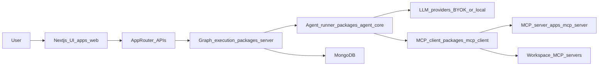

# Kletron architecture

One-page map for contributors. **Deeper notes:** [docs/architecture.md](./docs/architecture.md) · **historical tables:** [docs/README-archive.md](./docs/README-archive.md).

## System diagram

## Where things live

| Location | Responsibility |
|----------|------------------|
| `apps/web` | Next.js UI, App Router, marketing pages, API routes calling `packages/server` |
| `apps/mcp-server` | Bundled MCP tool server (SSE); tools under `apps/mcp-server/tools/` |
| `apps/desktop` | Electron desktop host |
| `apps/cli` | CLI entrypoints for workflows |
| `packages/agent-core` | LangGraph-style agents, graph definitions consumed by the server |
| `packages/server` | Mongo persistence, auth helpers, workspace/org services, graph executor glue |
| `packages/shared` | Types, Zod schemas, pure utilities |
| `packages/ui` | Design system, React components, tokens |
| `packages/mcp-client` | Multi-client MCP wrapper used by agent runtime |
| `packages/bridge` | Desktop/web bridge utilities |

## Dependency rules

- `packages/ui` **must not** import runtime server code (type-only imports allowed).
- `packages/shared` has **no** IO / network / DB.
- `packages/agent-core` may depend on `shared` and server-side execution helpers as wired today.
- `packages/server` orchestrates persistence and calls into `agent-core` / `mcp-client`.

## Data flow (one paragraph)

The user drives **Next.js** (`apps/web`). Route handlers call **`packages/server`** services, which run **agent graphs** from **`packages/agent-core`**. Tool calls go through **`packages/mcp-client`** to the **bundled MCP server** (`apps/mcp-server`) and any **workspace-attached MCP** processes. Durable config and runs land in **MongoDB**.

## Local dev processes

`npm run dev` ([`scripts/dev-all.ts`](./scripts/dev-all.ts)) typically starts: MCP (port **9000**), LangGraph dev (**8080**), web (**3000**), desktop, terminal worker — subject to your machine and env.

## Related docs

- [CONTRIBUTING.md](./CONTRIBUTING.md) — how to run and PR
- [community/README.md](./community/README.md) — plugin-shaped contributions
- [ROADMAP.md](./ROADMAP.md) — themes
