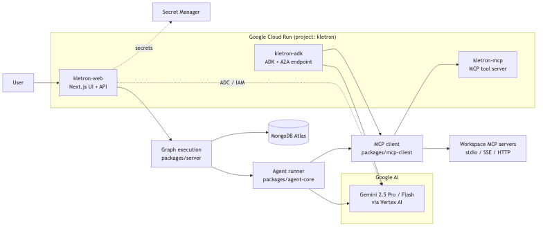
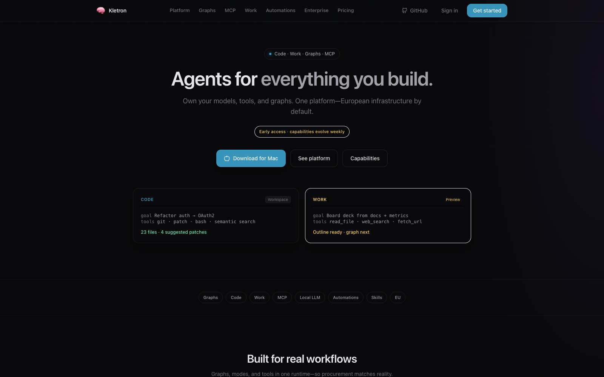
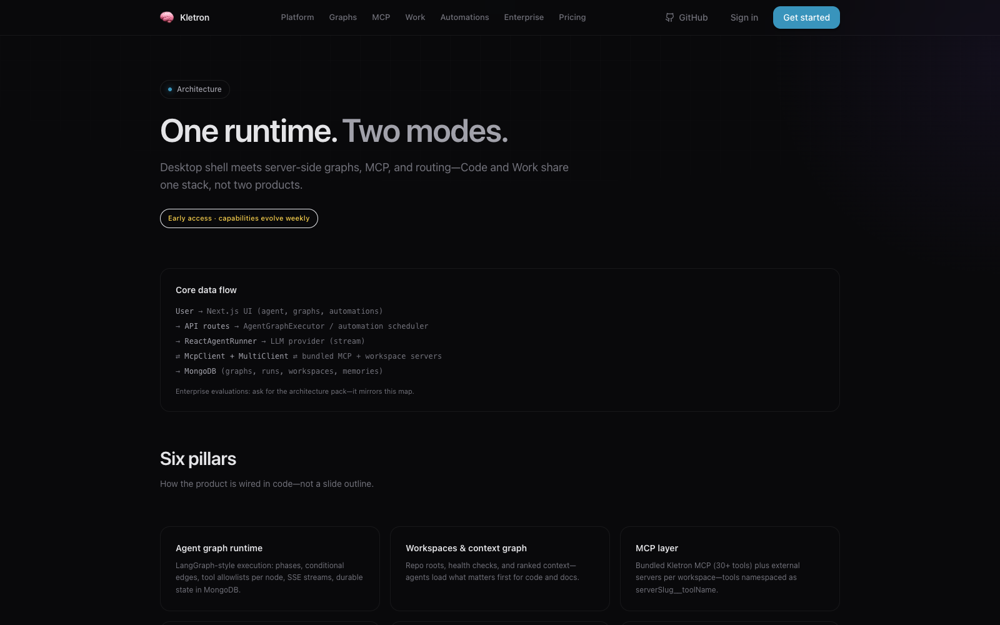
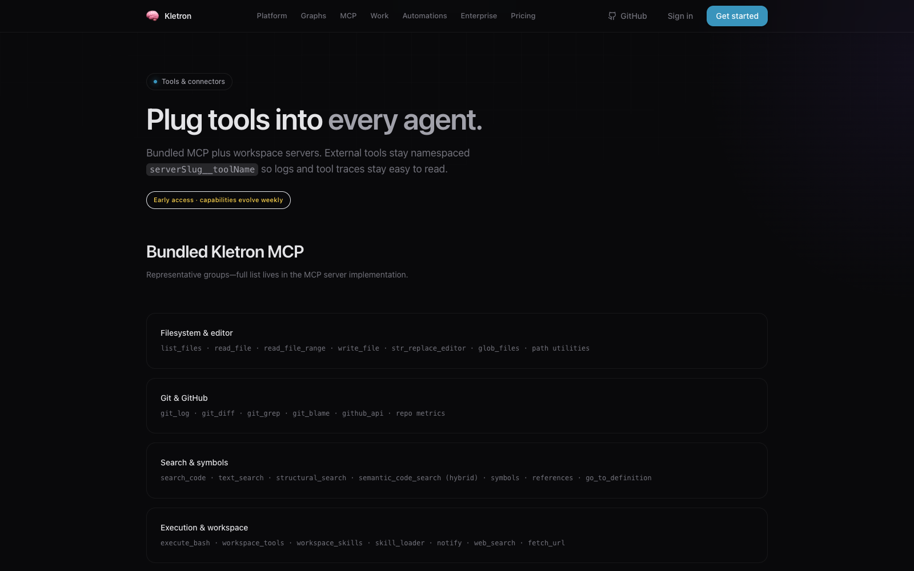
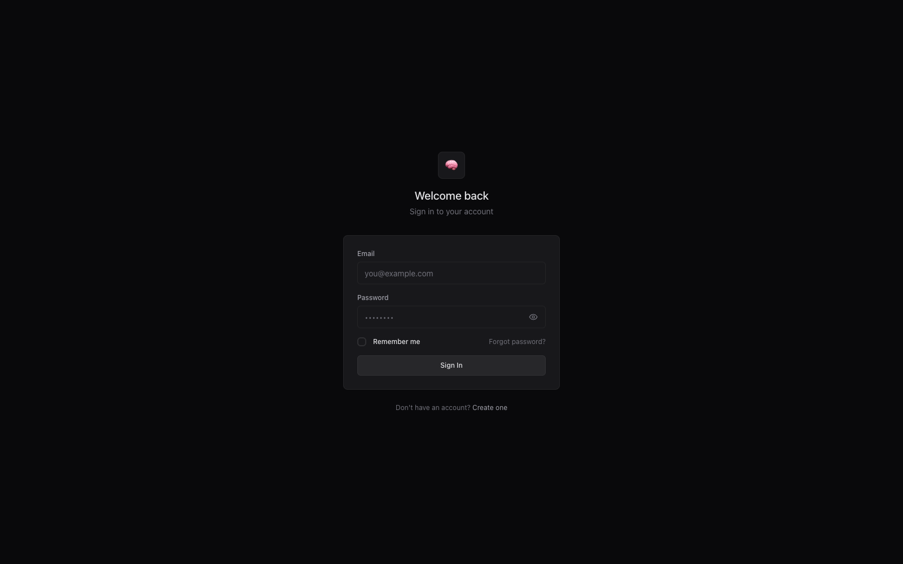

# Kletron

**MCP-native agent graphs with a real UI.** Local-first / BYOK — run models on your keys or on your machine.

[](./LICENSE)
[](#google-cloud-deployment)
[](#google-cloud-deployment)

> **Submitted to the [Google for Startups AI Agents Challenge](https://googleforstartups-aiagents.devpost.com/) — Track 3: *Refactor for Google Cloud Marketplace & Gemini Enterprise*.**
> Live demo: <https://www.kletron.com> · credentials: `demo@kletron.local` / `kletron-demo` · ADK/A2A endpoint: see [`apps/mcp-server/adk-entrypoint.ts`](./apps/mcp-server/adk-entrypoint.ts).



Kletron is a TypeScript monorepo: **Next.js** app, **Electron** desktop, **MCP tool server**, and shared **agent/graph** packages. Compose multi-node graphs, attach workspace MCP servers, and ship with traces—not a single opaque chat thread.

## Product tour

<table>
  <tr>
    <td width="50%"><a href="./docs/assets/screenshot-landing.png"></a></td>
    <td width="50%"><a href="./docs/assets/screenshot-platform.png"></a></td>
  </tr>
  <tr>
    <td><sub><b>Landing.</b> Agent graphs, MCP tools, and a real UI — local-first / BYOK.</sub></td>
    <td><sub><b>Platform.</b> Six pillars: graph runtime, workspace context, MCP layer, modes, automations, EU posture.</sub></td>
  </tr>
  <tr>
    <td><a href="./docs/assets/screenshot-mcp.png"></a></td>
    <td><a href="./docs/assets/screenshot-login.png"></a></td>
  </tr>
  <tr>
    <td><sub><b>MCP.</b> Bundled toolset (file I/O, git, search, exec) plus workspace-scoped servers — tools stay namespaced.</sub></td>
    <td><sub><b>Sign in.</b> Self-serve auth. The hosted demo at <a href="https://www.kletron.com">www.kletron.com</a> uses <code>demo@kletron.local</code> / <code>kletron-demo</code>.</sub></td>
  </tr>
</table>

| Start here | |
|------------|--|
| **Run in ~15 min** | [Quickstart](#quickstart) |
| **Where code lives** | [ARCHITECTURE.md](./ARCHITECTURE.md) |
| **MCP connectors (full doc)** | [docs/mcp-connectors-integration.md](./docs/mcp-connectors-integration.md) |
| **Send a PR** | [CONTRIBUTING.md](./CONTRIBUTING.md) |
| **Plugins & presets** | [community/README.md](./community/README.md) |
| **Themes / priorities** | [ROADMAP.md](./ROADMAP.md) |
| **Codex + Google connectors** | [Codex backend + Google Workspace connectors](#codex-backend--google-workspace-connectors) |

**Community:** GitHub Discussions on your fork (enable in repo settings) · Discord: coming soon.

---

## Quickstart

**Prerequisites:** Node 20+, Docker (for Mongo), `git`.

```bash
git clone https://github.com/rom-ai-in/kletron.git
cd kletron
cp env.example .env
# Edit .env: set NEXTAUTH_SECRET, MCP_INTERNAL_TOKEN, and LM Studio / Azure keys (see MINIMUM section in env.example)
```

**One path (Make):**

```bash
make quickstart
```

**Same path (npm + shell):**

```bash
npm run quickstart
# or: ./bin/quickstart.sh
```

This starts **MongoDB**, installs deps, runs **`npm run seed:demo`** (demo user + [`examples/quickstart-workspace`](./examples/quickstart-workspace) + default graphs), then **`npm run dev`** (MCP + LangGraph dev + web + desktop launcher per [scripts/dev-all.ts](./scripts/dev-all.ts)).

**Log in after seed**

- URL: `http://localhost:3000/auth/login` (or your `NEXT_PUBLIC_APP_URL`)
- Email: `demo@kletron.local`
- Password: `kletron-demo`

---

## Why Kletron (vs wiring LangGraph + a random UI yourself)

- **Graph editor + runtime** — presets, branching, and traces in product, not only in notebooks.
- **MCP everywhere** — bundled tools + **workspace-scoped** MCP (stdio / SSE / HTTP); tools namespaced for readable logs.
- **BYOK & local models** — LM Studio, Ollama, vLLM, plus cloud APIs; you control spend and data routing.
- **EU / self-host posture** — run the stack where your policy says; see [Enterprise](https://kletron.com/enterprise) for managed options.
- **Contributor-friendly surface** — [`community/`](./community/) for MCP templates, graph JSON presets, and skills without touching core internals.

---

## Repo layout (short)

| Path | Role |
|------|------|
| `apps/web` | Next.js UI + App Router APIs |
| `apps/mcp-server` | MCP SSE server (tools) |
| `apps/desktop` | Electron shell |
| `apps/cli` | CLI entrypoints |
| `packages/agent-core` | Graphs, agents, workflows |
| `packages/server` | DB, auth helpers, graph execution services |
| `packages/ui` | Design system & shared UI |
| `packages/shared` | Types & pure utilities |
| `packages/mcp-client` | MCP client |

Deep dive tables and API notes live in **[docs/README-archive.md](./docs/README-archive.md)** (archived long README).

---

## Google Cloud deployment

Kletron ships first-class **Google Gemini** and **Vertex AI** providers, and runs on **Google Cloud Run** out of the box (`infra/gcp/`).

| Surface | Path | Notes |
|---------|------|-------|
| Gemini (AI Studio API) | Settings → LLM → **Google Gemini** | Paste a key from <https://aistudio.google.com/apikey>. Code: [`packages/server/src/llm.ts`](./packages/server/src/llm.ts) `case "gemini"`. |
| Vertex AI (Gemini Enterprise) | Settings → LLM → **Vertex AI** | Set Google Cloud project + location. On Cloud Run, leave credentials empty — Application Default Credentials are used via the attached service account. Code: same file, `case "vertex"`. |
| ADK + A2A endpoint | `npm run dev:adk` | Wraps the Simple ReAct node as a Google ADK `LlmAgent` and serves it over the A2A protocol. Source: [`packages/agent-core/src/adk/kletronAgent.ts`](./packages/agent-core/src/adk/kletronAgent.ts), [`apps/mcp-server/adk-entrypoint.ts`](./apps/mcp-server/adk-entrypoint.ts). |
| Cloud Run deploy | `./infra/gcp/vertex-ai-setup.sh && ./infra/gcp/deploy.sh` | Builds & rolls `kletron-web` + `kletron-mcp` to Cloud Run, wires Vertex env vars, grants the `Vertex AI User` role to the runtime service account. |

After deploy, the web service auto-reads `GOOGLE_CLOUD_PROJECT`, `GOOGLE_CLOUD_LOCATION`, and `VERTEX_MODEL` and lights up the Vertex provider with zero per-user key management.

See [ARCHITECTURE.md](./ARCHITECTURE.md) for the full Google Cloud topology.

---

## LM Studio on a remote machine (GPU server)

LM Studio can run on a separate GPU host while you use Kletron from the web or from your Mac. Expose the LM Studio server to Kletron via an SSH tunnel or an HTTPS tunnel (ngrok, Cloudflare Tunnel, etc.), then set the LM Studio **Base URL** in Kletron to the reachable endpoint (it must include the `/v1` suffix). For hosted Kletron, also set `WORKSPACE_SKIP_LOCAL_FS_VALIDATION` so workspace paths are not validated against the server's local filesystem.

For **hosted Kletron + real files on your laptop**, see **[docs/workspace-local-files-hosted-kletron.md](./docs/workspace-local-files-hosted-kletron.md)** (`WORKSPACE_SKIP_LOCAL_FS_VALIDATION` + `KLETRON_REMOTE_FILE_MCP_SLUG` and a tunneled local MCP).

---

## Codex backend + Google Workspace connectors

When **Execution backend = Codex** (web or Electron), Kletron spawns the Codex CLI with  
`CODEX_HOME=$HOME/.kletron/codex/<userHash>` — **not** `~/.codex`. If you never use the Codex CLI directly, you can ignore `~/.codex/config.toml`; Kletron maintains its own Codex state under `~/.kletron/codex/`.

**Server `.env`:** set `GOOGLE_OAUTH_CLIENT_ID` and `GOOGLE_OAUTH_CLIENT_SECRET` (same OAuth client as **Configuration → Connectors**).

**Google Cloud Console** (project that owns that OAuth client): enable **Gmail API**, **Gmail MCP API** (`gmailmcp.googleapis.com`), **Google Calendar API**, and **Google Drive API** as needed.

**In the app:** connect **Gmail**, **Google Calendar**, and **Google Drive** under Connectors and enable them for the workspace. LangGraph runs use Kletron-stored tokens directly. Codex runs additionally wire Gmail into the Codex process (refresh token → ADC JSON + bearer for Google’s hosted Gmail MCP; curated Gmail plugin is disabled to avoid ChatGPT-only credentials).

---

## Telegram (Messenger channel)

1. **HTTPS URL** — Telegram requires a public `https://` endpoint. Local dev: use a tunnel (ngrok, Cloudflare Tunnel, etc.) toward your Next.js port (default `3000`).
2. **Secrets** — In the app: **Configuration → Messenger channels**. Save the bot token there (requires `KLETRON_CHANNEL_SECRETS_KEY` on the server) or set `CHANNEL_TELEGRAM_BOT_TOKEN` in `.env`. Optionally set `CHANNEL_TELEGRAM_WEBHOOK_SECRET` and the same value as `secret_token` when registering the webhook.
3. **GCP prod (`kletron` project)** — Put Telegram vars in repo-root `.env`, then run `gcloud config set project kletron` and `python3 infra/gcp/provision_secrets.py`. That creates Secret Manager entries (`kletron-channel-telegram-*`) and binds **Cloud Run `kletron-web`**. Cloud Build deploys attach the same secrets if they already exist. Scripts refuse GCP project IDs containing `numezis`.
4. **Register the webhook** — After Cloud Run has the token + webhook secret, run `./infra/gcp/set-telegram-webhook.sh` (reads `.env`, defaults to `https://www.kletron.com`) or call Telegram manually:

   ```bash
   curl -sS "https://api.telegram.org/bot<YOUR_BOT_TOKEN>/setWebhook" \
     -d "url=https://your-host.example.com/api/webhooks/channels/telegram" \
     -d "secret_token=<same as CHANNEL_TELEGRAM_WEBHOOK_SECRET>"
   ```

5. **Link your account** — In the web app **Messenger channels**: enter your Telegram user id and link so routing can find your Kletron user (required — otherwise « not linked »).
6. **Workspace & graph** — In **Messenger channels**, pick the workspace and set **default agent graph** + **Telegram enabled**. In Telegram use `/switch`, `/graphs`, `/graph clear` for per-chat overrides.
7. **Queue** — By default, webhook updates are stored in MongoDB (`channel_inbound_jobs`) and drained FIFO so multiple server instances do not drop work. For single-process in-process handling only, set `CHANNEL_TELEGRAM_QUEUE_BACKEND=memory`.
8. **Tool approvals** — New Telegram runs default to `CHANNEL_TELEGRAM_THREAD_APPROVAL_MODE=full_auto_thread` so read-only tools run without the web UI; set `confirm_everything` if you want every tool to queue for approval (you would approve in the Kletron web app, not in Telegram).

See **`env.example`** for all related variables.

---

## Docker

- **Default:** `docker compose up -d mongo` — local database only (used by `npm run dev:infra`).
- **Optional profile:** `docker compose --profile fullstack up -d --build` — builds **web** + **mcp-server** images (smoke / prod-like; set secrets via `.env` or compose defaults).

---

## Scripts (root)

| Script | Purpose |
|--------|---------|
| `npm run quickstart` | Mongo + install + `seed:demo` + `dev` |
| `npm run dev` | Full dev stack ([scripts/dev-all.ts](./scripts/dev-all.ts)) |
| `npm run seed:demo` | Demo user + workspace + graphs |
| `npm run typecheck` / `npm run lint` / `npm run test:unit` | CI checks |

---

## License

MIT — see [LICENSE](./LICENSE).
