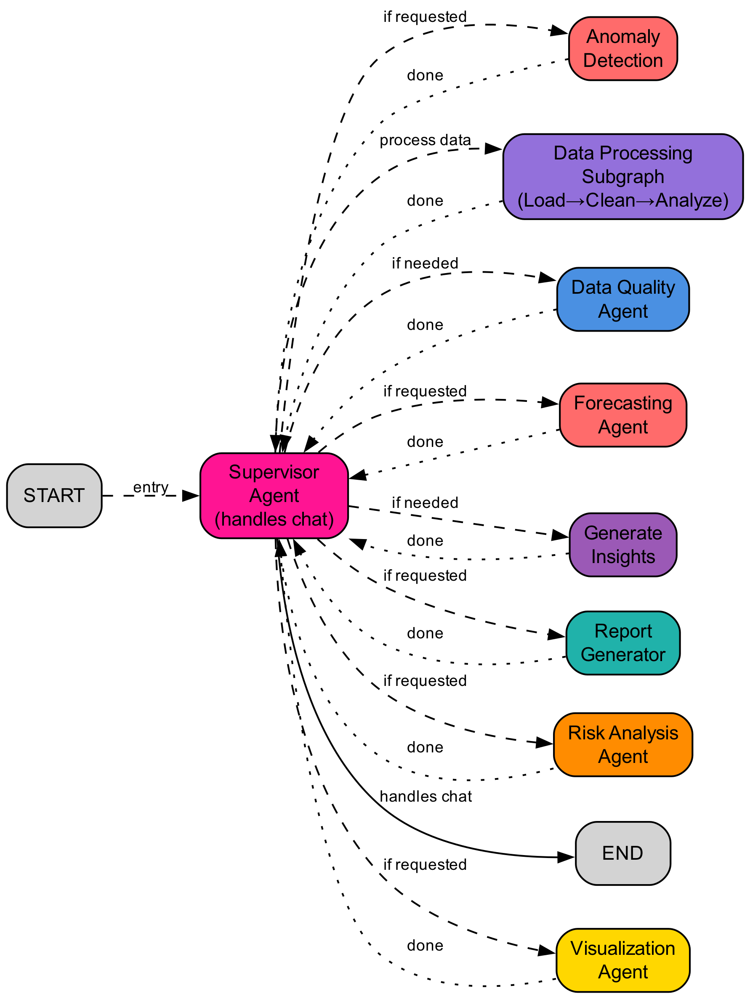

# 🧾 LangGraph Finance Analyzer

A production-ready LangGraph workflow demonstrating a **multi-agent financial analysis system** that automatically loads, cleans, normalizes, analyzes, and generates insights from raw financial CSV data.

## 📊 Architecture



The system uses a supervisor pattern with specialized agents:
- **Supervisor Agent** - Intelligent routing and orchestration
- **Data Quality Agent** - Validates input data
- **Data Processing Pipeline** - Load → Clean → Analyze
- **Analysis Agents** - Visualization, Forecasting, Anomaly Detection, Risk Analysis, Report Generation

## 🚀 Quick Start

### Prerequisites

- Python 3.8+
- Azure OpenAI API credentials

### Installation

```bash
# Clone the repository
git clone https://github.com/rmagnin88/fin-agent.git
cd fin-agent

# Install dependencies
pip install -r requirements.txt

# Configure environment
cp env.example .env
# Edit .env with your Azure OpenAI credentials
```

### Run the Demo

#### Option A: LangGraph Studio (Recommended)

```bash
langgraph dev
```

Open the URL shown in the output (or go to https://smith.langchain.com) and interact with the graph visually.

#### Option B: Command Line

```bash
python run_demo.py
```

#### Option C: Programmatic Usage

```python
from graph import app

result = app.invoke({
    "raw_csv": csv_content,
    "csv_path": "your_financials.csv"
})

print(result["insights"])
```

## 📁 Project Structure

```
fin-agent/
├── graph.py              # Main LangGraph workflow definition
├── run_demo.py           # Interactive demo runner
├── test_workflow.py      # Unit tests
├── export_graph.py       # Graph visualization exporter
├── sample_financials.csv # Sample financial dataset
├── requirements.txt      # Python dependencies
├── env.example           # Environment variables template
├── langgraph.json        # LangGraph configuration
└── graph/                # Graph visualizations
    └── finance_analyzer.png
```

## 🔧 Configuration

Create a `.env` file with your Azure OpenAI credentials:

```env
AZURE_OPENAI_API_KEY=your_azure_openai_api_key_here
AZURE_OPENAI_ENDPOINT=https://your-resource.cognitiveservices.azure.com
AZURE_OPENAI_MODEL=gpt-5-mini
AZURE_OPENAI_DEPLOYMENT=gpt-5-mini
AZURE_OPENAI_API_VERSION=2024-12-01-preview
AZURE_OPENAI_MAX_TOKENS=4096
```

Optional: For LangGraph Studio and LangSmith tracing:

```env
LANGSMITH_API_KEY=your_langsmith_api_key_here
LANGGRAPH_API_KEY=your_langgraph_api_key_here
```

## 🌟 Features

- ✅ **Intelligent Data Cleaning** - Automatically removes formatting, handles missing values
- ✅ **Smart Column Detection** - Identifies sales, profit, country, segment columns automatically
- ✅ **Comprehensive Analysis** - Computes totals, averages, top performers, breakdowns
- ✅ **AI-Powered Insights** - Generates narrative summaries with business recommendations
- ✅ **Multi-Agent Architecture** - Specialized agents for visualization, forecasting, anomaly detection, risk analysis
- ✅ **Flexible Input** - Works with CSV files or raw CSV strings
- ✅ **Error Handling** - Graceful fallbacks if data is malformed

## 📚 Resources

- [LangGraph Documentation](https://langchain-ai.github.io/langgraph/)
- [LangGraph Studio Guide](https://langchain-ai.github.io/langgraph/tutorials/studio/)

## 📝 License

MIT License - see LICENSE file for details
