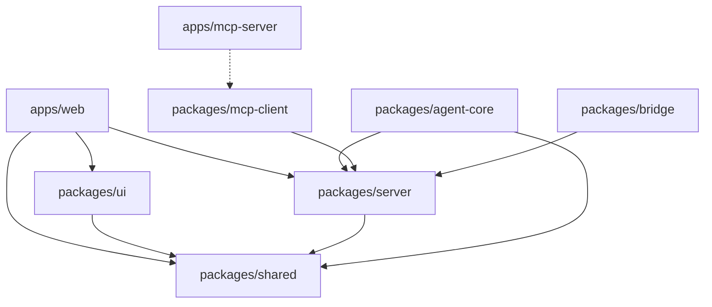
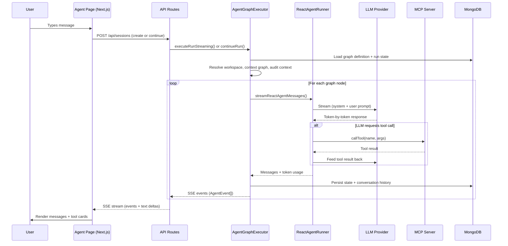

# Architecture Overview

> Exhaustive technical documentation of the Kletron agentic system — 100% aligned with the actual codebase.

## Monorepo Structure

```
kletron/
├── apps/
│   ├── web/            # Next.js web application (agent UI, API routes)
│   ├── mcp-server/     # MCP tool server (33 tools, JavaScript)
│   ├── cli/            # CLI interface
│   ├── desktop/        # Desktop application (Electron)
│   └── config/         # Configuration app
├── packages/
│   ├── agent-core/     # ReAct agent runner + LangGraph graphs
│   ├── bridge/         # Git operations + workspace file I/O
│   ├── mcp-client/     # MCP client singleton (SSE/Stdio)
│   ├── server/         # Backend services (graph executor, LLM, context, memory)
│   ├── shared/         # Shared types, schemas, graph catalog
│   └── ui/             # React components + hooks (Agent UI, design system)
├── scripts/            # Seed scripts for agent graphs
├── supabase/           # Supabase auth configuration
└── templates/          # Document templates (Word, PowerPoint)
```

## Package Dependency Graph



## Core Data Flow



## MongoDB Collections

| Collection | Purpose | Key Fields |
|---|---|---|
| `agent_graphs` | Graph definitions (nodes, edges, execution config) | `name`, `nodes[]`, `edges[]`, `execution` |
| `agent_graph_runs` | Run state and history | `graphId`, `status`, `state`, `conversationHistory`, `tokenUsage` |
| `agent_memories` | Agent persistent memory (file-path based) | `workspaceId`, `path`, `content` |
| `llm_config` | Runtime LLM provider configuration | `defaultProvider`, `azure`, `openai`, `claude`, etc. |
| `user_preferences` | Per-user UI preferences | `selectedLlmProvider`, `selectedGraphId` |
| `workspaces` | Workspace definitions | `rootPath`, `name`, `health` |

## Key Source Files Map

| Component | Source File | Lines |
|---|---|---|
| ReAct Agent Runner | `packages/agent-core/src/reactAgentRunner.ts` | 341 |
| Simple React Graph | `packages/agent-core/src/simpleReactGraph.ts` | 56 |
| Graph Executor | `packages/server/src/services/agentGraphExecutor.ts` | 2423 |
| Graph Types | `packages/server/src/services/agentGraphTypes.ts` | 216 |
| Graph Service | `packages/server/src/services/agentGraphService.ts` | 195 |
| Graph Presets | `packages/server/src/services/agentGraphPresets.ts` | 2484 |
| Graph Runtime | `packages/server/src/services/agentGraphRuntime.ts` | 45 |
| Graph Topo Sort | `packages/server/src/services/agentGraphTopo.ts` | 62 |
| Graph Conditions | `packages/server/src/services/agentGraphConditions.ts` | — |
| Graph State | `packages/server/src/services/agentGraphState.ts` | — |
| Graph Utils | `packages/server/src/services/agentGraphUtils.ts` | — |
| LLM Provider | `packages/server/src/llm.ts` | 372 |
| MCP Client | `packages/mcp-client/src/client.ts` | 188 |
| MCP Server | `apps/mcp-server/server.js` | — |
| Context Graph Store | `packages/server/src/context/graph/ContextGraphStore.ts` | 156 |
| Context Ranker | `packages/server/src/context/graph/ContextRanker.ts` | 123 |
| Context Scanner | `packages/server/src/context/graph/ContextScanner.ts` | 95 |
| Context Types | `packages/shared/src/context/graph/ContextGraphTypes.ts` | 72 |
| Agent Memory | `packages/server/src/services/agentMemoryService.ts` | 143 |
| Graph Catalog | `packages/shared/src/graphCatalog.ts` | 159 |
| Bridge (Git) | `packages/bridge/src/index.ts` | 379 |
| Agent Page | `apps/web/app/app/agent/page.tsx` | 1277 |
| useAgentSession | `packages/ui/src/hooks/useAgentSession.ts` | 295 |

## Technology Stack

| Layer | Technology |
|---|---|
| Frontend | Next.js 14 (App Router), React, TypeScript |
| Backend | Node.js, TypeScript |
| AI Framework | LangChain/LangGraph |
| LLM Providers | Azure OpenAI, OpenAI, Anthropic, Google Gemini, LM Studio, Ollama, vLLM |
| Tool Protocol | Model Context Protocol (MCP) |
| Database | MongoDB (Azure Cosmos DB compatible) |
| Auth | Supabase Auth |
| Git | simple-git |
| Streaming | Server-Sent Events (SSE) |
