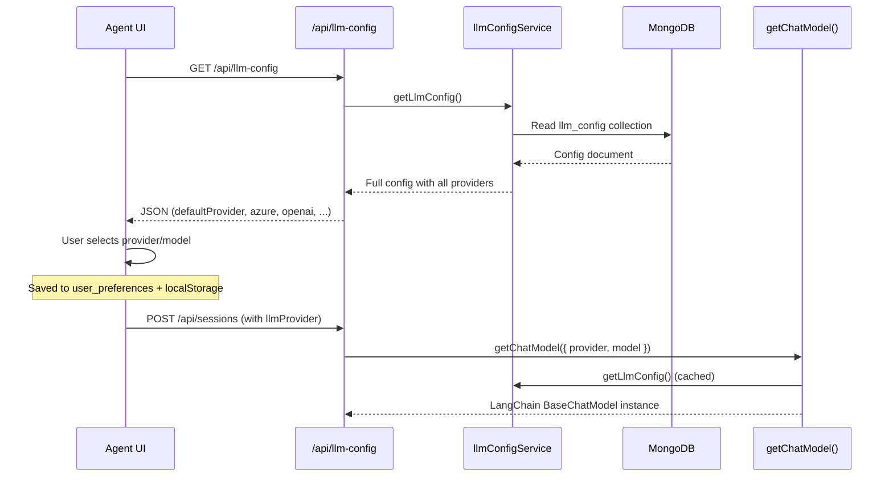

# LLM Providers

> Source: `packages/server/src/llm.ts` (372 lines)

## Overview

The LLM layer provides a unified interface for 7 AI providers via LangChain chat models. All configuration is stored in MongoDB and loaded at runtime via `getLlmConfig()` from `llmConfigService`. Provider selection happens per-request, allowing users to switch models from the UI without server restart.

## Supported Providers

| Provider | LangChain Class | Config Key | Required Fields |
|---|---|---|---|
| Azure OpenAI | `AzureChatOpenAI` | `azure` | `endpoint`, `apiKey`, `deployment`, `apiVersion` |
| OpenAI | `ChatOpenAI` | `openai` | `apiKey`, `model` |
| Claude (Anthropic) | `ChatAnthropic` | `claude` | `apiKey`, `model` |
| Gemini (Google) | `ChatGoogleGenerativeAI` | `gemini` | `apiKey`, `model` |
| LM Studio | `ChatOpenAI` (OpenAI-compatible) | `lmstudio` | `baseUrl`, `model` |
| Ollama | `ChatOllama` | `ollama` | `baseUrl`, `model` |
| vLLM | `ChatOpenAI` (OpenAI-compatible) | `vllm` | `baseUrl`, `model` |

## Core Functions

### `getChatModel(selection?, overrides?)`

**Async** factory function returning a LangChain `BaseChatModel` instance.

```typescript
export async function getChatModel(
  selection?: Partial<LlmSelection>,  // { provider, model }
  overrides?: ChatModelOverrides       // { temperature, maxTokens, topP, ... }
): Promise<BaseChatModel>
```

**Resolution order:**
1. `selection.provider` → explicit provider choice
2. `runtimeConfig.defaultProvider` → MongoDB config default
3. Throws error if neither exists

**Model overrides** (supported on LM Studio and vLLM):
- `temperature`, `maxTokens`, `topP`, `topK`, `repeatPenalty`, `presencePenalty`, `frequencyPenalty`
- Per-model settings stored in `modelSettings[modelName]` in MongoDB config

### `resolveResolvedLlmInfo(selection?)`

Returns debugging metadata about the resolved provider:

```typescript
type ResolvedLlmInfo = {
  provider: LlmProvider;
  model?: string;
  azure?: { deployment?, endpoint?, apiVersion? };
  openai?: { organization? };
  lmstudio?: { baseUrl? };
  ollama?: { baseUrl? };
  vllm?: { baseUrl? };
};
```

### `parseLlmSelectionInput(input?)`

Normalizes raw user input into a partial `LlmSelection`. Used by API routes to safely parse request bodies.

## Provider-Specific Details

### Azure OpenAI
- Extracts instance name from endpoint URL: `new URL(endpoint).hostname.split(".")[0]`
- Requires `azureOpenAIApiVersion` for API versioning
- Model specified via `deployment` name in config

### LM Studio / vLLM
- Uses `ChatOpenAI` with custom `baseURL` configuration
- API key defaults to `"lm-studio"` / `"vllm"` (local models don't need real keys)
- vLLM auto-appends `/v1` to base URL for OpenAI compatibility
- Supports advanced model kwargs: `top_k`, `repeat_penalty`

### Ollama
- Uses dedicated `ChatOllama` class
- Connects via `baseUrl` (typically `http://localhost:11434`)

## Runtime Configuration Flow



## Frontend Integration

The `useAgentSession` hook (`packages/ui/src/hooks/useAgentSession.ts`) manages LLM selection:

1. **Loads config** at mount: `GET /api/llm-config` → full config + `GET /api/llm-config/enable` → enabled providers list
2. **Provider options**: Built dynamically from `enabledProviders` + per-provider model name from config
3. **Health check**: `useLlmHealth(provider)` returns `success | error | loading | none`
4. **Persistence**: Selection saved to both API (`user_preferences`) and `localStorage` as fallback
5. **Auto-correct**: If selected provider is disabled, auto-switches to first enabled provider

## Temperature Default

All providers default to `temperature: 1` unless overridden:
- Per-request override via `ChatModelOverrides.temperature`
- Per-model override via `modelSettings[model].temperature` (LM Studio / vLLM only)
