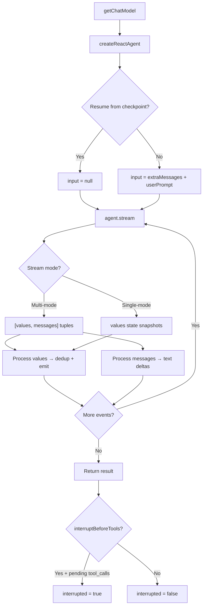

# ReAct Agent Runner

> Source: `packages/agent-core/src/reactAgentRunner.ts` (341 lines)  
> Source: `packages/agent-core/src/simpleReactGraph.ts` (56 lines)

## Overview

The ReAct Agent Runner is the core execution engine for individual agent nodes. It wraps LangGraph's `createReactAgent` to provide:
- Dual-mode streaming (state snapshots + token-by-token)
- Message deduplication (ID-based + content fingerprint)
- Token usage tracking
- Checkpoint-based persistence for human-in-the-loop
- Cooperative abort control

## `streamReactAgentMessages(opts)`

Main entry point. Creates a LangGraph ReAct agent, streams execution, and returns accumulated results.

### Input Options

```typescript
type StreamReactAgentOptions = {
  name: string;                    // Agent identity (e.g. "SimpleReactGraphAgent")
  systemPrompt: string;            // System message for the LLM
  userPrompt: string;              // User input message
  tools: any[];                    // LangChain tool instances
  workspaceRoot?: string;          // Workspace path (injected into configurable)
  llmSelection?: LlmSelection;    // { provider, model } override
  extraMessages?: BaseMessage[];   // Previous conversation history (multi-turn)
  
  // Callbacks
  onMessage?: (msg) => void;       // Called for each new AI/tool message
  onTokenUsage?: (usage, model) => void;  // Token usage per LLM response
  onTextDelta?: (delta) => void;   // Token-by-token text streaming
  
  // Abort control
  abortSignal?: AbortSignal;       // External abort signal
  getAbortReason?: () => AgentWorkflowAbortReason | null;
  shouldAbort?: () => AgentWorkflowAbortReason | null;  // Cooperative check
  
  // Checkpoint / persistence
  checkpointer?: BaseCheckpointSaver;    // LangGraph checkpoint saver
  threadId?: string;                      // Unique thread ID
  interruptBeforeTools?: boolean;         // Human-in-the-loop: pause before tools
  resumeFromCheckpoint?: boolean;         // Resume from saved state
};
```

### Output

```typescript
type StreamReactAgentResult = {
  messages: BaseMessage[];     // All messages from the conversation
  tokenUsage: TokenUsage;     // Accumulated { inputTokens, outputTokens, totalTokens }
  model: string;              // Resolved model name
  interrupted?: boolean;      // True if interrupted for human approval
};
```

## Execution Flow



## Dual-Mode Streaming

When `onTextDelta` is provided, the agent uses **multi-mode streaming** with `streamMode: ["values", "messages"]`:

| Mode | Data Shape | Purpose |
|---|---|---|
| `values` | `{ messages: BaseMessage[] }` | Complete state snapshots for deduplication |
| `messages` | `[AIMessageChunk, metadata]` | Token-by-token text deltas for progressive rendering |

**Text delta filtering**: Only non-tool-call assistant chunks are emitted (chunks with `tool_calls` or `tool_call_chunks` are skipped).

## Message Deduplication

The runner uses a **two-layer deduplication strategy**:

### Layer 1: ID-based (`seenMessageIds`)
Each message's `id` field is tracked. Messages with duplicate IDs are skipped.

### Layer 2: Content fingerprint (`seenContentFingerprints`)
A fingerprint is computed for each message:
```
{type}:{content[0..500]}{:tc=toolName1,toolName2}{:tcid=toolCallId}
```
This catches duplicates even when LangGraph reassigns or transforms message IDs internally.

### Seeding
When `extraMessages` are provided (multi-turn), their IDs and fingerprints are pre-seeded to ensure historical messages are not re-emitted.

## Callback Filtering

The `shouldEmitToCallback` function filters which messages reach `onMessage`:
- **Skipped**: `human`/`user` messages (already known by the UI)
- **Skipped**: `system` messages (configured out-of-band)
- **Emitted**: `ai`/`assistant` and `tool` messages

## Token Usage Extraction

Token usage is extracted from LangChain's `usage_metadata` on each message:

```typescript
{
  inputTokens: usageMetadata.input_tokens ?? usageMetadata.prompt_tokens,
  outputTokens: usageMetadata.output_tokens ?? usageMetadata.completion_tokens,
  totalTokens: usageMetadata.total_tokens
}
```

Usage is tracked per-message (via `seenUsageIds`) and accumulated into `totalUsage`.

## Abort Control

Three abort mechanisms work together:

1. **`abortSignal`**: `AbortController.signal` passed to LangGraph's `stream()`. When aborted, throws `AgentWorkflowAbortError`.
2. **`getAbortReason()`**: Returns the reason when `abortSignal` fires (e.g., `"PAUSED"`, `"CANCELLED"`).
3. **`shouldAbort()`**: Cooperative check called every 500ms during stream processing. Returns a reason to abort or `null` to continue.

```typescript
class AgentWorkflowAbortError extends Error {
  reason: AgentWorkflowAbortReason;  // "PAUSED" | "CANCELLED" | ...
}
```

## Checkpoint & Human-in-the-Loop

When `interruptBeforeTools` is enabled with a `checkpointer`:

1. `createReactAgent` is configured with `interruptBefore: ["tools"]`
2. The agent pauses when the LLM requests tool calls
3. The stream ends normally but `interrupted = true` is set
4. Detection: last AI message has `tool_calls` with no matching `ToolMessage` responses
5. The caller persists status as `"PAUSED"` and waits for human approval
6. On approval, `resumeFromCheckpoint = true` resumes from the saved state

### Stream Configuration

```typescript
const streamConfig = {
  streamMode: "values" | ["values", "messages"],
  recursionLimit: config.graphRecursionLimit,
  signal: opts.abortSignal,
  configurable: {
    thread_id: opts.threadId,
    checkpoint_ns: "",
    workspaceRoot: opts.workspaceRoot,
  }
};
```

## SimpleReactGraph

`packages/agent-core/src/simpleReactGraph.ts` defines the simplest possible graph — a single LangGraph `StateGraph` node:

```typescript
const SimpleReactAnnotation = Annotation.Root({
  messages: MessagesAnnotation.spec.messages,
  userRequest: Annotation<string>,   // Input
  finalAnswer: Annotation<string>,   // Output
});

const graph = new StateGraph(SimpleReactAnnotation)
  .addNode("simple_react", simpleReactNode)
  .addEdge(START, "simple_react")
  .addEdge("simple_react", END)
  .compile();
```

This graph is used for LangGraph Studio compatibility and the `langgraph.json` entry point. It calls `streamReactAgentMessages` internally with `simpleReactSystemPrompt` and `allMcpTools`.
