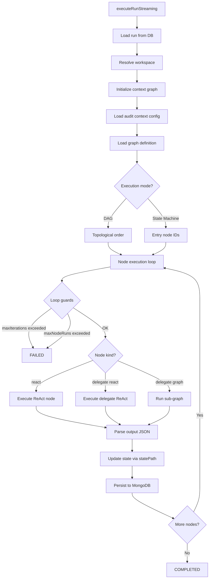

# Agent Graph Executor

> Source: `packages/server/src/services/agentGraphExecutor.ts` (2423 lines)

## Overview

The `AgentGraphExecutor` is the runtime engine that powers all agentic workflows. It orchestrates graph execution, manages state persistence, emits real-time events via SSE, and handles multi-turn conversations, checkpointing, and error recovery.

## Entry Points

### `executeRun(runId)`
Delegates to `executeRunStreaming(runId)`.

### `executeRunStreaming(runId, opts?)`
Main execution method. Loads a run from MongoDB, resolves its graph, and executes all nodes.

### `continueRun(runId, message, opts?)`
Multi-turn continuation. Appends user message to conversation history and re-executes.

## Execution Flow



## Initialization Sequence

For each run, the executor performs:

1. **Load run** from `agentGraphRunService.getRun(runId)`
2. **Resolve workspace**: `getWorkspaceByIdUnsafe(workspaceId)` or fallback to first workspace
3. **Bind workspace context**: `runWithWorkspaceContext(workspace, callback)`
4. **Initialize context graph**: `ensureContextGraphReady(workspaceId, rootPath)` — loads or scans if empty
5. **Setup checkpoint saver** (if `enableCheckpoints`): `getCheckpointSaver()`
6. **Load audit context**: `getAuditContextConfig(workspaceId)`
7. **Load graph definition**: `agentGraphService.getGraph(graphId)`
8. **Resolve execution mode**: `resolveExecutionMode(graph)` → `"dag"` or `"state_machine"`
9. **Determine node order**: `topoSortAgentGraph()` (DAG) or entry nodes (state machine)
10. **Build initial state**: Clone run state, inject audit context
11. **Initialize token tracking**: `tokenUsageService.startRunTracking(runId)`
12. **Build timeline**: One `TimelineEvent` per node (all `"pending"`)
13. **Initialize conversation history**: Append initial user event

## Node Execution

For each node in the execution queue:

### 1. Guard Checks
- `totalSteps > maxIterations` (default 200) → FAIL
- `nodeRunCounts[nodeId] > maxNodeRuns` (default 20) → FAIL
- `ensureNotAborted()` → cooperative abort check

### 2. Tool Assembly
```typescript
const nodeTools = selectToolsByName(node.react.toolNames, localTools);
// localTools includes: write_todos (with dedup guard)
```

### 3. System Prompt Construction
The system prompt is built by concatenating:
1. Node's `react.systemPrompt`
2. Injected agent skills (from `skillRegistry` via `skillIds`)
3. Audit context (if enabled)
4. Context graph ranked items
5. Tool preference guidance

### 4. User Prompt Rendering
Uses `renderUserPrompt(template, state)`:
- Replaces `{{mission}}`, `{{state.xxx}}` placeholders
- Handles nested paths: `{{state.drift.validatedRisks}}`

### 5. LLM Execution
```typescript
const result = await streamReactAgentMessages({
  name: node.label,
  systemPrompt: enrichedSystemPrompt,
  userPrompt: renderedPrompt,
  tools: nodeTools,
  extraMessages: conversationMessages,  // Multi-turn history
  llmSelection: node.react.llmSelection ?? opts?.llmSelectionOverride,
  onMessage: async (message) => { /* emit AgentEvent */ },
  onTokenUsage: async (usage, model) => { /* track usage */ },
  onTextDelta: opts?.onTextDelta,
  abortSignal, shouldAbort, checkpointer, threadId,
});
```

### 6. Output Processing
1. **Parse JSON**: `parseJsonOutput(lastMessage.content, schemaId)`
2. **Validate against schema**: `nodeOutputSchemaRegistry[schemaId]` — schema lookup via bracket access from `@kletron/shared/nodeOutputSchemas`
3. **Write to state**: `setNestedValue(state, statePath, validated)` with optional `stateMerge`
4. **Execute JSON actions**: `maybeExecuteJsonActionTool()` for `generic_json` nodes

## Event Stream

Every LLM message is converted to an `AgentEvent`:

```typescript
type AgentEvent = {
  id: string;           // "event-0", "event-1", ...
  phaseId: string;      // Node ID
  phaseLabel: string;   // Node label
  kind: "user" | "assistant" | "tool" | "system";
  role: string;
  name?: string;        // Tool name
  toolCallId?: string;
  content: string;
  toolNote?: string;    // AI text accompanying tool calls
  toolArgs?: string;    // Serialized tool arguments
  isError?: boolean;
  thoughts?: string[];  // Extracted reasoning
  timestamp: string;
};
```

### Kind Assignment
| Message Type | Kind |
|---|---|
| Tool result (`type === "tool"`) | `"tool"` |
| System message | `"system"` |
| User/Human message | `"user"` |
| Everything else | `"assistant"` |

## Thinking/Reasoning Extraction

The executor extracts LLM reasoning from three sources (in order):

### 1. Structured Thinking (Claude)
Array content blocks with `type: "thinking"`:
```json
[{ "type": "thinking", "thinking": "Let me analyze..." }, { "type": "text", "text": "The answer is..." }]
```

### 2. Provider-Specific kwargs
- **Anthropic**: `additional_kwargs.thinking`
- **OpenAI**: `additional_kwargs.reasoning_content` or `additional_kwargs.reasoning`

### 3. `<think>` Tags
Regex extraction from text content: `/<think>([\s\S]*?)<\/think>/gi`

### 4. Heuristic Fallback
If no structured thinking found:
- Split on `Final:` / `Answer:` markers → text before = thoughts
- Check if first paragraph contains reasoning cue words (`we need to`, `let's`, `goal`, etc.)

## Tool Result Eviction

Large tool results (>80,000 chars) are **evicted** to disk:

```
.kletron/agent-cache/{runId}/{toolName}-{nodeId}-{uuid}.txt
```

The in-context result is replaced with a preview:
```
Tool result exceeded 80000 chars and was evicted.
Saved to: .kletron/agent-cache/...
Preview (first 2000 chars):
[preview text]
```

Environment variables:
- `TOOL_RESULT_EVICT_CHARS` (default: 80000)
- `TOOL_RESULT_PREVIEW_CHARS` (default: 2000)

## write_todos Tool

A custom LangChain tool injected into every node:

```typescript
const writeTodosTool = createTool(async (input) => {
  // Normalize tasks: ensure id, title, status
  // Dedup guard: hash payload, reject if same hash N times
  // Update state.taskQueue and state.currentTaskId
  // Persist state to MongoDB
}, { name: "write_todos", schema: z.object({...}) });
```

**Dedup guard**: If the same payload is sent 2+ consecutive times, the tool returns a warning instead of updating.

## Multi-Turn Conversations

### `continueRun(runId, message, opts?)`

1. **Load run** from DB
2. **Resolve workspace** and bind context
3. **Check for checkpoint resume**:
   - If `status === "PAUSED"` with `checkpoint.status === "awaiting_approval"`:
   - Verify graph hash matches (detect graph definition changes)
   - Reset interrupted node to PENDING
   - Resume via `executeRunStreaming` with `resumeFromCheckpoint: true`
4. **Standard continuation**:
   - Append user message to `state.conversationHistory`
   - Update `state.mission` to new message
   - Reset all node statuses to PENDING
   - Increment `conversationTurns`
   - Call `executeRunStreaming()`

### Conversation History Conversion

`convertConversationHistoryToMessages(events)` converts `AgentEvent[]` back to `BaseMessage[]`:

| Event Kind | Message Type |
|---|---|
| `user` | `HumanMessage` |
| `system` | `SystemMessage` |
| AI tool-call event | `AIMessage` with `tool_calls[]` |
| `assistant` (no tools) | `AIMessage` |
| `tool` | `ToolMessage` |

Content is sanitized via `sanitizeAssistantVisibleContent()` and `stripThoughtContent()` to prevent prompt leakage.

## Memory Path Routing

When filesystem tools (`list_files`, `read_file`, `write_file`) target paths starting with `/memories/`, the executor intercepts and routes to `agentMemoryService` instead of the MCP filesystem tools.

```typescript
const extractMemoryPath = (toolName, input) => {
  // list_files → input.path
  // read_file/write_file → input.filePath
  // Normalize and validate starts with /memories/
};
```

## Checkpoint Management

| Function | Purpose |
|---|---|
| `getCheckpointSaver()` | Get or create MongoDB checkpoint saver |
| `hasCheckpoint(threadId)` | Check if checkpoint exists |
| `computeGraphHash(nodes, edges)` | FNV-1a hash for version guard |
| `ensureCheckpointIndexes()` | Create MongoDB indexes |
| `deleteThreadCheckpoints(threadId)` | Cleanup after run completion |

**Graph version guard**: Before resuming, the executor compares `checkpoint.graphHash` with `computeGraphHash(currentGraph)`. If different, falls through to standard multi-turn continuation.

## Error Handling

| Error Type | Run Status | Recovery |
|---|---|---|
| `AgentWorkflowAbortError("PAUSED")` | `PAUSED` | Resume via `continueRun` |
| `AgentWorkflowAbortError("CANCELLED")` | `CANCELLED` | Manual restart |
| Missing node in graph | `FAILED` | Fix graph + restart |
| Max iterations exceeded | `FAILED` | Increase limit or fix logic |
| LLM connection failure | `FAILED` | Check provider config |
| Any other error | `FAILED` | Review error message |
