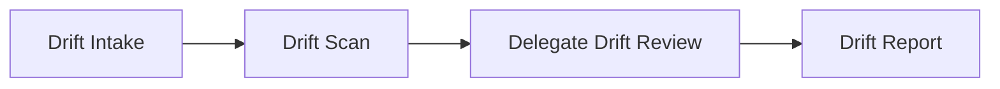

# Graph Presets

> Source: `packages/server/src/services/agentGraphPresets.ts` (2484 lines)

## Overview

The presets file defines 6 ready-to-use `AgentGraphDefinition` configurations, each tailored for a specific use case. Each preset includes system prompts, tool allowlists, output schema bindings, and execution topology.

## Preset Graphs

| Preset | Builder Function | Category | Nodes | Mode |
|---|---|---|---|---|
| Simple ReAct | `buildSimpleReactAgentGraph()` | `graph` | 1 | — |
| Coder Agent | `buildCoderAgentGraph()` | `graph` | 1 | — |
| Explorer Agent | `buildExplorerAgentGraph()` | `graph` | 1 | — |
| Planner Agent | `buildPlannerAgentGraph()` | `graph` | 1 | — |
| Drift Analysis | `buildDriftAnalysisGraph()` | `drift` | 4 | DAG |
| Business Analyst | `buildBusinessAnalystGraph()` | `business_analysis` | — | — |

## Tool Allowlists

### CURSOR_CORE_TOOLS (22 tools)
Base set for investigation and code analysis:
```
glob_files, list_files, read_file, read_file_range, search_code, repo_metrics,
dependency_info, describe_structure, git_log, git_diff, git_grep,
git_blame, semantic_code_search, structural_search, symbols_list,
find_symbol, go_to_definition, references,
execute_bash, output_format, write_todos
```

### CURSOR_RESEARCH_TOOLS (24 tools)
Core + web access:
```
...CURSOR_CORE_TOOLS, web_search, fetch_url
```

### CURSOR_CODER_TOOLS (24 tools)
Core + file modification:
```
...CURSOR_CORE_TOOLS, write_file, str_replace_editor
```

### simpleReactToolNames (full general-purpose set)
```
glob_files, list_files, read_file, read_file_range, search_code, repo_metrics,
dependency_info, describe_structure, git_log, git_diff, git_grep,
git_blame, semantic_code_search, structural_search, symbols_list,
find_symbol, go_to_definition, references,
execute_bash, output_format, write_file, str_replace_editor, web_search, fetch_url,
write_todos, list_available_skills, load_skill
```

## Preset Details

### 1. Simple ReAct Agent

**Identity**: "Kletron" — autonomous software engineering agent  
**Single node**: `simple_react` with `simpleReactSystemPrompt`  
**Output schema**: `conversational` (no JSON parsing)  
**Tools**: 23 tools (`simpleReactToolNames`)

**System prompt structure** (285 lines):
1. **Critical mandatory rules**: 5 rules enforcing tool verification
2. **Identity**: Senior staff engineer persona
3. **Core operating model**: 7-step ReAct loop (Understand → Plan → Gather → Reason → Execute → Verify → Output)
4. **Repository First Principle**: Always inspect code before assumptions
5. **Tool usage strategy**: Ordered information flow (overview → locate → inspect → trace → analyze → implement → shell)
6. **Multi-step execution**: Use `write_todos` once for task queues
7. **Code understanding strategy**: Entrypoints → modules → dependencies → call chains
8. **Debugging strategy**: Reproduce → locate → trace → identify → fix → validate
9. **Implementation strategy**: Minimal diff, match style, avoid new deps
10. **Conversational output**: No headers/separators, natural pair-programmer style
11. **Safety rules**: Never hallucinate, always verify via tools
12. **Performance rules**: Minimal calls, precise queries
13. **Termination condition**: Stop when task is solved

### 2. Coder Agent

**Identity**: "Kletron Coder" — implementation engine  
**Tools**: `CURSOR_CODER_TOOLS` (core + `write_file` + `str_replace_editor`)  
**Focus**: Task queue execution, minimal diffs, production-quality code

**Distinct system prompt elements**:
- Operates from task queue (read → execute → update status → repeat)
- Strict code modification rules (targeted edits, no full rewrites)
- Safe edit patterns (check existing file first, preserve structure)

### 3. Explorer Agent

**Identity**: "Kletron Explorer" — research and investigation agent  
**Tools**: `CURSOR_RESEARCH_TOOLS` + `todo_search`, `bootstrap_context`, `github_api`  
**Focus**: Deep investigation, evidence gathering, web research

**Distinct system prompt elements**:
- Read-only mode (no file modifications)
- Evidence-based analysis
- Web research enabled

### 4. Planner Agent

**Identity**: "Kletron Planner" — architecture and planning agent  
**Tools**: Read-only analysis tools + `write_todos` + `output_format`  
**Focus**: Task decomposition, planning, definition of done

**Distinct system prompt elements**:
- Produces structured plans with task queues
- Defines acceptance criteria and constraints
- No execution (planning only)

### 5. Drift Analysis (Multi-Node DAG)

4-node directed acyclic graph with specialized agents:



| Node | Kind | Tools | Output Schema |
|---|---|---|---|
| `drift_intake` | react | None | `cursor_intake_output` → `state` |
| `drift_scan` | react | CURSOR_RESEARCH_TOOLS | `cursor_researcher_output` → `state` |
| `drift_delegate` | delegate (react) | CURSOR_CORE_TOOLS | `generic_json` → `state.drift` |
| `drift_report` | react | None | `cursor_done_output` → `state` |

**Drift Intake**: Extracts investigation scope from user request (goal, constraints, open questions). No tools — pure LLM reasoning.

**Drift Scan**: Investigates the repository for configuration, dependency, deployment, infrastructure, and feature flag drift. Collects evidence with file paths and line numbers.

**Delegate Drift Review**: Validates scanner findings, removes false positives, identifies root causes, prioritizes risks. Uses the `delegate` node kind with `summaryPrompt`.

**Drift Report**: Synthesizes findings into `finalSummary` and `nextSteps`. No tools.

**Output schema pattern**: Each node writes to a `statePath` with `stateMerge: true`, allowing cumulative state building across the pipeline.

### 6. Business Analyst

Multi-node graph for business analysis workflows.

## Prompt Template Variables

User prompt templates use `{{variable}}` syntax:

| Variable | Resolves To |
|---|---|
| `{{mission}}` | `state.mission` |
| `{{state}}` | `JSON.stringify(state, null, 2)` |
| `{{state.goal}}` | Nested state value |
| `{{state.constraints}}` | Nested state value |
| `{{state.drift}}` | Nested state value |
| `{{state.workingNotes}}` | Nested state value |

## Default Graph Seeding

On user registration, `agentGraphService.ensureDefaultGraphs()` seeds `buildSimpleReactAgentGraph()` by name matching. The seed scripts in `scripts/` can be run manually:

```bash
npx tsx scripts/seed-agent-graph-simple-react.ts
npx tsx scripts/seed-agent-graph-drift.ts
npx tsx scripts/seed-agent-graphs-all.ts
```
