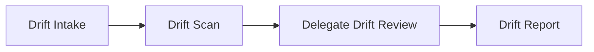

# Graph Presets

> Source: `packages/server/src/services/agentGraphPresets.ts`

## Overview

The presets file defines many `AgentGraphDefinition` builders. **Production database seeding** (`scripts/seed-agent-graphs-all.ts`, `ensureDefaultGraphs()` on registration, and **`apps/web/instrumentation.ts`** on each web server boot) keeps **five** single-node LangGraph ReAct graphs: **Company Growth & GTM**, **Operations / Incident**, **Coder**, **Planner**, and **Explorer**. Disable boot sync locally with `KLETRON_SKIP_CANONICAL_GRAPH_SYNC_ON_BOOT=true`. The same file still exports **Simple ReAct**, **Drift Analysis**, **Business Analyst**, **Code Comparator**, and others for manual creation or tooling.

**Company growth / GTM** uses `buildCompanyGrowthWorkGraph()` with node id `company_growth_react` so Work mode does not replace its system prompt with the generic `simple_react` work swap.

## Canonical graphs (default DB)

| Role | Preset | Builder | Node id |
|---|---|---|---|
| Work / company growth | Company Growth & GTM (work graph) | `buildCompanyGrowthWorkGraph()` | `company_growth_react` |
| Work / operations | Operations / Incident (work graph) | `buildOperationsIncidentWorkGraph()` | `operations_incident_react` |
| Code | Coder Agent (agent graph) | `buildCoderAgentGraph()` | `coder_react` |
| Plan (code) | Planner Agent (agent graph) | `buildPlannerAgentGraph()` | `planner_react` |
| Explore (code) | Explorer Agent (agent graph) | `buildExplorerAgentGraph()` | `explorer_react` |

## Other exported builders (not in default seed)

| Preset | Builder | Notes |
|---|---|---|
| Simple ReAct | `buildSimpleReactAgentGraph()` | General single-node ReAct; create manually if needed |
| Drift Analysis | `buildDriftAnalysisGraph()` | 4-node DAG |
| Business Analyst | `buildBusinessAnalystGraph()` | Multi-node BA workflow |
| Code Comparator | `buildCodeComparatorGraph()` | Comparator workflow |

## Tool Allowlists

### CURSOR_CORE_TOOLS (21 tools)
Base set for investigation and code analysis (note: **Coder** and **Planner** presets prepend `glob_files` / `bootstrap_context` where needed):
```
list_files, read_file, read_file_range, search_code, repo_metrics,
dependency_info, describe_structure, git_log, git_diff, git_grep,
git_blame, semantic_code_search, structural_search, symbols_list,
find_symbol, go_to_definition, references,
execute_bash, output_format, write_todos
```

### CURSOR_RESEARCH_TOOLS (24 tools)
Core + web access:
```
...CURSOR_CORE_TOOLS, web_search, fetch_url
```

### CURSOR_CODER_TOOLS (24 tools)
Core + file modification:
```
...CURSOR_CORE_TOOLS, write_file, str_replace_editor
```

### simpleReactToolNames (full general-purpose set)
```
glob_files, list_files, read_file, read_file_range, search_code, repo_metrics,
dependency_info, describe_structure, git_log, git_diff, git_grep,
git_blame, semantic_code_search, structural_search, symbols_list,
find_symbol, go_to_definition, references,
execute_bash, output_format, write_file, str_replace_editor, web_search, fetch_url,
write_todos, list_available_skills, load_skill
```

## Preset Details (canonical five)

### 1. Company Growth & GTM (work graph)

**Identity**: "Kletron — Company Growth & GTM"  
**Node id**: `company_growth_react` (not `simple_react`, so the dedicated prompt is preserved in Work mode)  
**Tools**: `simpleReactToolNames` (general-purpose work + code tool surface)  
**Focus**: Sales, BD, fundraising narrative, marketing/growth, daily/weekly operating rhythm — grounded in workspace markdown and optional web tools when allowed.

### 2. Operations / Incident (work graph)

**Identity**: "Operations & Incident Response"  
**Node id**: `operations_incident_react`  
**Tools**: `simpleReactToolNames` plus `sentry_api`, `github_api`  
**Focus**: Production incidents, Sentry triage, operational checks, evidence-backed next actions.

### 3. Coder Agent

**Identity**: "Kletron" — autonomous coding agent  
**Tools**: `glob_files`, `bootstrap_context`, `CURSOR_CORE_TOOLS`, `write_file`, `str_replace_editor`  
**Focus**: Task queue execution, minimal diffs, production-quality code, exhaustive discovery when needed

**Distinct system prompt elements**:
- Operates from task queue (read → execute → update status → repeat)
- Strict code modification rules (targeted edits, no full rewrites)
- Safe edit patterns (check existing file first, preserve structure)
- Breadth-then-depth repository discovery; optional structured markdown in long answers

### 4. Explorer Agent (code)

**Identity**: "Kletron Explorer" — repository audit / architecture exploration  
**Tools**: `glob_files`, `CURSOR_RESEARCH_TOOLS`, `todo_search`, `bootstrap_context`, `github_api`  
**Focus**: Read-only investigation, evidence-backed reporting, optional fenced JSON appendix for downstream tooling

**Distinct system prompt elements**:
- Read-only mode (no file modifications)
- Evidence-based analysis
- Web research enabled
- Single-node ReAct (no separate synthesizer node)

### 5. Planner Agent (code)

**Identity**: "Kletron Planner" — architecture and planning agent  
**Tools**: `glob_files`, `bootstrap_context`, read-only analysis subset + `write_todos` + `output_format`  
**Focus**: Task decomposition, planning, definition of done

**Distinct system prompt elements**:
- Produces structured plans with task queues
- Defines acceptance criteria and constraints
- No execution (planning only)
- Discovery rules aligned with breadth-then-depth until impact surface is clear

### Drift Analysis (Multi-Node DAG) — optional

4-node directed acyclic graph with specialized agents:



| Node | Kind | Tools | Output Schema |
|---|---|---|---|
| `drift_intake` | react | None | `cursor_intake_output` → `state` |
| `drift_scan` | react | CURSOR_RESEARCH_TOOLS | `cursor_researcher_output` → `state` |
| `drift_delegate` | delegate (react) | CURSOR_CORE_TOOLS | `generic_json` → `state.drift` |
| `drift_report` | react | None | `cursor_done_output` → `state` |

**Drift Intake**: Extracts investigation scope from user request (goal, constraints, open questions). No tools — pure LLM reasoning.

**Drift Scan**: Investigates the repository for configuration, dependency, deployment, infrastructure, and feature flag drift. Collects evidence with file paths and line numbers.

**Delegate Drift Review**: Validates scanner findings, removes false positives, identifies root causes, prioritizes risks. Uses the `delegate` node kind with `summaryPrompt`.

**Drift Report**: Synthesizes findings into `finalSummary` and `nextSteps`. No tools.

**Output schema pattern**: Each node writes to a `statePath` with `stateMerge: true`, allowing cumulative state building across the pipeline.

### Business Analyst — optional

Multi-node graph for business analysis workflows (`buildBusinessAnalystGraph()`). Not inserted by `seed-agent-graphs-all.ts`.

## Prompt Template Variables

User prompt templates use `{{variable}}` syntax:

| Variable | Resolves To |
|---|---|
| `{{mission}}` | `state.mission` |
| `{{state}}` | `JSON.stringify(state, null, 2)` |
| `{{state.goal}}` | Nested state value |
| `{{state.constraints}}` | Nested state value |
| `{{state.drift}}` | Nested state value |
| `{{state.workingNotes}}` | Nested state value |

## Default Graph Seeding

On user registration, `agentGraphService.ensureDefaultGraphs()` creates the **four canonical** graphs by name if they are missing. To reconcile the database with preset definitions and **remove** any non-canonical graphs:

```bash
npx tsx scripts/seed-agent-graphs-all.ts
```

Optional one-off scripts (`seed-agent-graph-simple-react.ts`, `seed-agent-graph-drift.ts`) still exist for manual use.
