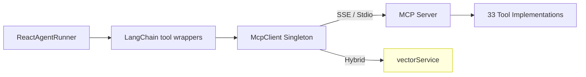

# MCP Tools

> Source: `apps/mcp-server/` (33 tools)  
> Source: `packages/mcp-client/src/client.ts` (188 lines)
>
> For the complete end-to-end product documentation (frontend + API + backend runtime + operations), see `docs/mcp-connectors-integration.md`.

## Overview

The Model Context Protocol (MCP) tool system provides the executable capabilities available to AI agents. Tools are implemented on the MCP server (JavaScript), accessed by the agent via the MCP client singleton, and filtered per-node via allowlists in graph definitions.

## Architecture



## MCP Client (`packages/mcp-client/src/client.ts`)

### Singleton Pattern
```typescript
class McpClient {
  private static instance: McpClient | null = null;
  
  static async getInstance(): Promise<McpClient> {
    // Returns existing instance or creates new one
  }
  
  static async reloadInstance(): Promise<McpClient> {
    // Stops background services, closes connection, re-initializes
  }
}
```

### Transport Selection

| Environment | Transport | Configuration |
|---|---|---|
| `MCP_URL` is set | SSE (`SSEClientTransport`) | Connects to `MCP_URL` (default: `http://localhost:9000/sse`) |
| `MCP_URL` not set | Stdio (`StdioClientTransport`) | Spawns `apps/mcp-server/server.js --mcp` |

### Hosted Kletron + local repo filesystem

When the web app runs on Cloud Run but workspace `rootPath` values point at developer laptops, set **`WORKSPACE_SKIP_LOCAL_FS_VALIDATION`** so APIs resolve workspaces without checking the path on the server. To execute **bundled** repo/git/bash tools against your machine, set **`KLETRON_REMOTE_FILE_MCP_SLUG`** to the workspace MCP connector slug and expose your local **`apps/mcp-server`** SSE endpoint via HTTPS. The agent core then routes listed tools as `<slug>__<toolName>` to that external server. See **[`docs/workspace-local-files-hosted-kletron.md`](../workspace-local-files-hosted-kletron.md)**.

### Hybrid Tool Pattern

`semantic_code_search` is handled **natively** by the client instead of being forwarded to the MCP server:

```typescript
async callTool(name: string, args: Record<string, unknown>) {
  if (name === "semantic_code_search") {
    const { semanticSearch } = await import("@kletron/server/services/vectorService");
    const results = await semanticSearch(query, options);
    return JSON.stringify(results, null, 2);
  }
  // All other tools → MCP server
  return this.client.callTool({ name, arguments: args });
}
```

### Auto-Indexing on Startup

When the client initializes (non-worker, non-test process), it starts background services:

1. **`startWatcher(workspaceId, rootPath)`**: File system watcher for real-time index updates
2. **`startAutoIndexScheduler(workspaceId, rootPath)`**: Periodic re-indexing
3. **`startAutomationScheduler()`**: Global automation scheduler (singleton)

Skipped when:
- `DISABLE_AUTO_INDEX=true`
- Running in Next.js worker process
- `NODE_ENV=test`
- Already initialized (global flag `__MCP_SERVICES_INITIALIZED__`)

## MCP Server (`apps/mcp-server/`)

### Tool Inventory (33 tools)

#### File Operations (4 tools)
| Tool | File | Purpose |
|---|---|---|
| `list_files` | `listFiles.js` | List directory contents with depth control |
| `glob_files` | `globFiles.js` | Find paths matching a glob pattern (ignore-safe) |
| `read_file` | `readFile.js` | Read file content (supports Office formats via `officeparser`) |
| `read_file_range` | `readFileRange.js` | Read specific line range from a file |
| `write_file` | `writeFile.js` | Create or overwrite file content |

#### Code Analysis (8 tools)
| Tool | File | Purpose |
|---|---|---|
| `search_code` | `searchCode.js` | Text/regex search across codebase |
| `structural_search` | `structuralSearch.js` | AST-based structural code search |
| `symbols_list` | `symbolsList.js` | List symbols in a file/directory |
| `find_symbol` | `findSymbol.js` | Find symbol definition by name |
| `go_to_definition` | `goToDefinition.js` | Navigate to symbol definition |
| `references` | `references.js` | Find symbol references |
| `text_search` | `textSearch.js` | Plain text search |

Legacy clients may still call `find_references`; the MCP server maps it to `references`.

#### Skills (via HTTP / workspace capabilities)

| Tool | File | Purpose |
|---|---|---|
| `list_available_skills` | `workspaceSkills.js` | Skills enabled for this workspace |
| `list_all_skills` | `skillLoader.js` | Full skills library (HTTP) |
| `list_skills` | `skillLoader.js` | Deprecated alias for `list_all_skills` |
| `load_skill` | `skillLoader.js` | Load skill body (`slug` or `skill_id`; gated when `enabledSkills` is known) |

#### Git Operations (5 tools)
| Tool | File | Purpose |
|---|---|---|
| `git_log` | `gitLog.js` | Git commit history |
| `git_diff` | `gitDiff.js` | Git diff output |
| `git_grep` | `gitGrep.js` | Git grep for pattern search |
| `git_blame` | `gitBlame.js` | Line-level blame annotations |
| `github_api` | `githubApi.js` | GitHub REST API proxy |

#### Repository Analysis (4 tools)
| Tool | File | Purpose |
|---|---|---|
| `repo_metrics` | `repoMetrics.js` | Repository statistics (files, lines, languages) |
| `dependency_info` | `dependencyInfo.js` | Package dependency analysis |
| `describe_structure` | `describeStructure.js` | Directory tree description |
| `bootstrap_context` | `bootstrapContext.js` | Quick repo context summary |

#### Web & Research (2 tools)
| Tool | File | Purpose |
|---|---|---|
| `web_search` | `webSearch.js` | Tavily-powered web search |
| `fetch_url` | `fetchUrl.js` | HTTP fetch with HTML-to-text conversion |

#### Code Editing (1 tool)
| Tool | File | Purpose |
|---|---|---|
| `str_replace_editor` | `strReplaceEditor.js` | Find-and-replace in files (15KB implementation) |

#### Shell & System (1 tool)
| Tool | File | Purpose |
|---|---|---|
| `execute_bash` | `executeBash.js` | Execute shell commands |

#### Agent Features (5 tools)
| Tool | File | Purpose |
|---|---|---|
| `locate_ui_feature` | `locateUiFeature.js` | Find UI component by description |
| `todo_search` | `todoSearch.js` | Find TODO/FIXME comments |
| `output_format` | `outputFormat.js` | Format agent output |
| `notify` | `notify.js` | Send notifications (6.5KB implementation) |
| `write_todos` | *runtime-injected* | Update task queue (injected by executor) |

#### Skills (1 tool)
| Tool | File | Purpose |
|---|---|---|
| `load_skill` / `list_skills` | `skillLoader.js` | Browse and load agent skills |

#### Semantic Search (1 tool — hybrid)
| Tool | File | Purpose |
|---|---|---|
| `semantic_code_search` | *handled by McpClient* | Vector-based semantic code search |

### Supporting Utilities

| File | Purpose |
|---|---|
| `pathUtils.js` | Workspace-scoped path resolution |
| `globCache.js` | File glob caching |
| `tsService.js` | TypeScript language server integration |
| `gitUtils.js` | Git utility functions |

## Tool Configuration

### `config.js`
Server-level configuration:
- Workspace resolution from `config.json`
- Repository directory validation
- Path security (prevent directory traversal)

### `server.js` (11,954 bytes)
MCP server entry point:
- Tool registration via `registerXxx(server)` pattern
- SSE + Stdio transport support
- Request/response logging

## Tool Registration Flow

For a tool to be functional end-to-end:

```
1. Server Implementation (mcp-server/tools/myTool.js)
   → Export registerMyTool(server)

2. Server Registry (mcp-server/server.js)
   → Call registerMyTool(server) at startup

3. Graph Authorization (server/services/agentGraphPresets.ts)
   → Add "my_tool" to toolNames[] in relevant preset nodes

4. Database Sync (optional)
   → Run seed script to update MongoDB
```

## Path Resolution

All file-path tools resolve paths against the configured workspace root:
```javascript
// pathUtils.js
function resolvePath(inputPath) {
  // 1. Read workspace from config.json
  // 2. Resolve relative to workspace root
  // 3. Validate result is within allowed directories
  // 4. Throw if path escapes workspace scope
}
```

## Effective tool policy (single source of truth)

At every node execution the executor computes an **effective tool list** via
[`effectiveToolNames(...)`](../../packages/server/src/services/effectiveToolNames.ts):

```
effective = ((node.toolNames ∪ skill.tools ∪ admin.alwaysOn) ∩ caps.enabledToolSet)
            ∪ caps.externalNamespacedTools
```

- `node.toolNames` — declared on the graph node.
- `skill.tools` — `requiredTools + suggestedTools` of every enabled skill.
- `admin.alwaysOn` — names from `KLETRON_ADMIN_TOOL_NAMES` (see admin tools doc).
- `caps.enabledToolSet` — produced by `resolveWorkspaceCapabilities` (baseline + skill + integration tools + admin pack).
- `caps.externalNamespacedTools` — `slug__toolName` entries from connected external MCP servers.

The executor logs a warning whenever a node references a tool that is not in
the effective set, so misconfiguration becomes visible in the run timeline.

## External MCP servers (per-workspace)

Workspace connectors (Mongo `workspace_mcp_servers`) drive runtime MCP attachment.

**Invariants (do not regress):**

1. **Isolation** — `McpClient` keeps external connections under `(workspaceId → serverSlug → session)`. Syncing workspace A never tears down workspace B's connectors.
2. **Sync entrypoint** — [`syncWorkspaceExternalMcpServers(workspaceId)`](../../packages/server/src/services/mcpWorkspaceSync.ts) loads enabled servers via `getExternalMcpRuntimeConfig` and calls `McpClient.syncExternalServers(workspaceId, configs)`.
3. **Fresh tool lists** — Each sync re-runs `tools/list` on healthy sessions (and reconnects if listing fails) so renamed tools on the MCP server are picked up without restarting Kletron.
4. **Agent run** — The executor calls `syncWorkspaceExternalMcpServers` then [`buildDynamicExternalTools(workspaceId)`](../../packages/agent-core/src/tools/dynamicExternalTools.ts). Wrappers invoke `client.callTool("slug__toolName", args, { workspaceId })`.
5. **Approval / HTTP replay** — Routes such as agent-graph approvals and `/api/tools/execute` must call `syncWorkspaceExternalMcpServers` before `callTool` and pass `{ workspaceId }` so namespaced tools never fall through to the bundled MCP server.
6. **Routing** — Pure helper [`resolveExternalToolRoute`](../../packages/mcp-client/src/workspaceExternalRouting.ts) encodes ambiguous-slug rules; regression tests live in `packages/mcp-client/__tests__/workspaceExternalRouting.test.ts` and `packages/server/__tests__/mcpWorkspaceSync.test.ts`.
7. **Legacy** — `MultiMcpClient` uses one global external map and is **not** used by the agent; use `McpClient` for any new integration.

Schema strategy: when the server's JSON Schema is convertible we build a typed `z.object(...)`; otherwise we fall back to a passthrough object schema and let the server validate.

## Workspace-root pinning

Every MCP tool call requires a workspace root. The executor pins the
desktop-selected folder via `config.configurable.workspaceRoot`, which
`callMcpTool` reads first (then falls back to `runWithWorkspaceContext`,
finally throwing if neither is set). Stdio MCP processes also receive
`MCP_WORKSPACE_ROOT` so default-folder lookups stay correct.

## Run-level tool telemetry

Every node now records a `toolCallsSummary` on its timeline entry:

```ts
[
  { name: "read_file", count: 12, errors: 0, meanMs: 38 },
  { name: "search_code", count: 4, errors: 1, meanMs: 220 },
]
```

Use it to spot expensive tools, retries, and external MCP latency end-to-end.
