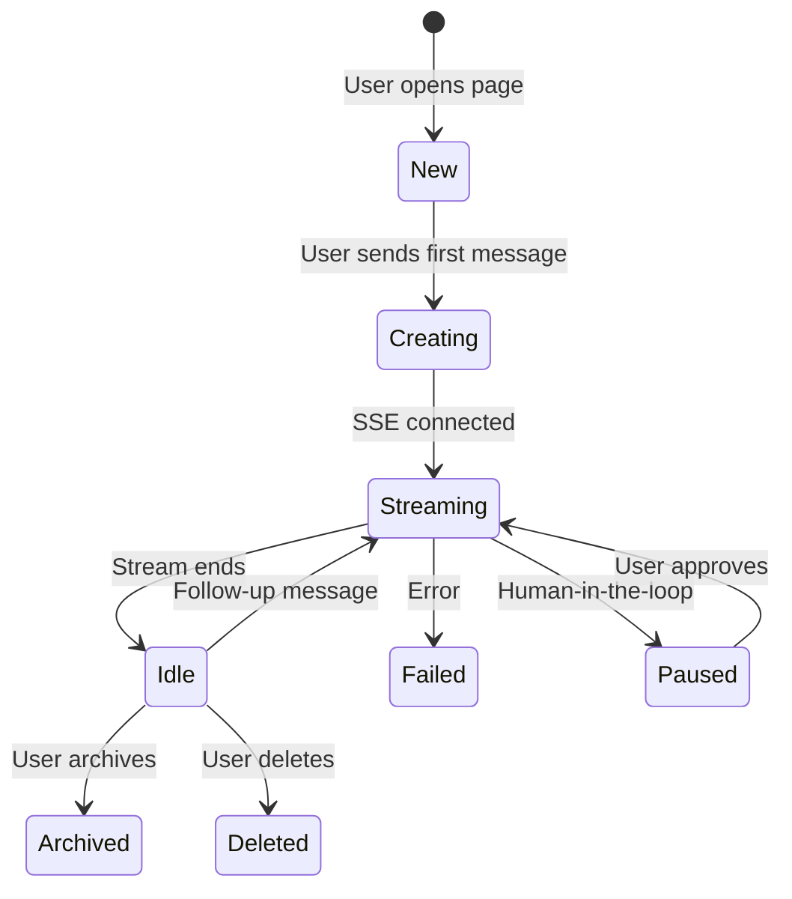

# Frontend Agent UI

> Source: `apps/web/app/app/agent/page.tsx` (1277 lines)  
> Source: `packages/ui/src/hooks/useAgentSession.ts` (295 lines)

## Overview

The Agent page is the primary user interface for interacting with the agentic system. It provides a chat-style interface with workspace-scoped sessions, real-time streaming, tool result visualization, and multi-turn conversation management.

## Page Architecture

```
┌────────────────────────────────────────────────────────────┐
│ WorkspaceLayout (global header + workspace switcher)       │
├──────────────┬─────────────────────────────────────────────┤
│              │                                             │
│  Project     │  Message Area                               │
│  Sidebar     │  ┌─────────────────────────────────────┐   │
│              │  │ "Load older messages" button         │   │
│  - Workspace │  │                                     │   │
│    name      │  │ Messages / Events / Tool Cards      │   │
│  - Session   │  │                                     │   │
│    threads   │  │ (MessageList or TimelinePanel)      │   │
│  - New       │  │                                     │   │
│    session   │  │                                     │   │
│  - Archive   │  │ Streaming indicator                 │   │
│  - Delete    │  │                                     │   │
│  - Rename    │  └─────────────────────────────────────┘   │
│              │                                             │
│              │  ┌─────────────────────────────────────┐   │
│              │  │ Message Queue (queued follow-ups)    │   │
│              │  └─────────────────────────────────────┘   │
│              │                                             │
│              │  ┌─────────────────────────────────────┐   │
│              │  │ AgentComposer                       │   │
│              │  │ [Text Input]           [Send/Stop]  │   │
│              │  │ [GRAPH: ▼]  [LLM: ▼]               │   │
│              │  └─────────────────────────────────────┘   │
├──────────────┴─────────────────────────────────────────────┤
│ Token Usage | Duration | Performance Debug (optional)      │
└────────────────────────────────────────────────────────────┘
```

## View Modes

The page dynamically switches between two view modes based on the graph structure:

| Mode | Condition | Component | UI |
|---|---|---|---|
| **Simple Chat** | `nodeCount <= 1` | `MessageList` | Flat chat with collapsible tool cards |
| **Timeline** | `nodeCount > 1` | `TimelinePanel` | Per-node timeline with phase status |

Detection logic:
```typescript
const isSimpleGraph = useMemo(() => {
  const agentGraph = agentGraphs.find(g => String(g._id) === selectedGraphId);
  return !agentGraph?.nodes?.length || agentGraph.nodes.length <= 1;
}, [selectedGraphId, agentGraphs]);
```

## Core Hooks

### `useAgentSession`

Manages graph and LLM selections with persistence:

**State**:
- `llmProvider` — selected LLM provider (default: `"azure"`)
- `selectedGraphId` — selected graph ID
- `enabledProviders` — providers enabled server-side
- `agentGraphs` — list of available graphs from API
- `llmConfigData` — full LLM config from server

**Data loading sequence**:
1. `GET /api/llm-config` → full config + default provider
2. `GET /api/user-preferences` → saved provider + graph selections
3. `GET /api/agent-graphs` → available graph definitions
4. `GET /api/llm-config/enable` → enabled providers list

**Persistence**: Changes saved to both API (`PATCH /api/user-preferences`) and `localStorage` as fallback.

**Graph resolution**: When preferences and graphs are both loaded, the hook resolves the selected graph:
1. Check if saved selection is valid
2. Fallback to "Simple ReAct (agent graph)" by name
3. Fallback to first available graph

### `useSessionStream`

Manages real-time SSE streaming and message state:

**State**:
- `messages` — accumulated messages
- `eventStream` — raw agent events
- `timeline` — DAG node status
- `sending` — whether a request is in flight
- `streamStatus` — `"idle"` | `"streaming"`
- `streamingText` — current token-by-token text
- `tokenUsage` — accumulated tokens
- `runStartedAt` / `runEndedAt` — timing

**Key function: `handleSend(opts)`**:
1. Creates new session (`POST /api/sessions`) or continues existing one
2. Opens SSE connection to `/api/sessions/{runId}/stream`
3. Processes NDJSON chunk types: `update`, `text_delta`, `error`, `done`
4. Handles message deduplication (content fingerprint + ID)
5. Provides `handleStop()` for abort

### `useSessionEdits`

Manages safe edit approvals for human-in-the-loop:
- `pendingEdits` — edits awaiting approval
- `approveEdit(id)` / `rejectEdit(id)` — individual decisions
- `approveAll()` / `rejectAll()` — batch operations

### `useMessageEdit`

Message editing with conversation replay:
- `editMessage(index, newContent)` — edit a previous message
- Truncation + resend via `POST /api/sessions/{id}/truncate`
- Replay confirmation dialog for destructive edits

## Session Management

### Session Lifecycle



### Session Storage
- Active session ID stored in `sessionStorage` (key: `agent-active-session`)
- Survives page refresh within the same browser tab
- Cleared on new session or workspace switch

### API Endpoints

| Method | Endpoint | Purpose |
|---|---|---|
| `POST` | `/api/sessions` | Create new session (run) |
| `GET` | `/api/sessions?limit=50&workspaceId=X` | List sessions |
| `GET` | `/api/sessions/{id}` | Get session detail + conversation history |
| `GET` | `/api/sessions/{id}/stream` | SSE stream |
| `PUT` | `/api/sessions/{id}/title` | Rename or auto-generate title |
| `POST` | `/api/sessions/{id}/truncate` | Truncate conversation for replay |
| `DELETE` | `/api/sessions/{id}` | Archive session |
| `DELETE` | `/api/sessions/{id}?action=delete` | Permanently delete |

### Auto-Title Generation

When a session is created, the first user message triggers auto-title generation:
```typescript
const handleTitleGenerate = async (runId, userMessage) => {
  // PUT /api/sessions/{runId}/title with { generate: true, userMessage }
  // Retries up to 3 times with exponential backoff (1.5s, 3s, 4.5s)
};
```

## Message Display

### ChatEvent Type
```typescript
type ChatEvent = {
  id: string;
  kind: "user" | "assistant" | "tool" | "system";
  content: string;
  toolName?: string;
  toolArgs?: string;
  toolOutput?: string;
  toolCallId?: string;
  isError?: boolean;
  thoughts?: string[];    // Extracted reasoning
  timestamp?: string;
  messageIndex?: number;  // For edit/replay
};
```

### Message Deduplication

Multiple layers prevent duplicate messages:

1. **ID dedup**: `seenIds` set tracks unique message IDs
2. **Content dedup**: Consecutive same-kind, same-content messages are skipped
3. **Stream vs load**: When transitioning from streaming to idle, `mergeMessages` keeps the richer dataset

### Message Normalization
```typescript
function normalizeMessage(raw): Message {
  // Extracts: id, role, content, timestamp, toolName, toolArgs, toolOutput, thoughts
  // Maps event kinds to message roles
}
```

## Workspace Integration

- **Workspace context**: via `useWorkspace()` hook
- **Session filtering**: Sessions are filtered by `activeWorkspaceId`
- **Auto-switch**: Selecting a session from a different workspace triggers automatic workspace switch
- **Workspace switch**: Explicit switch clears current session and reloads session list
- **Unhealthy workspaces**: Sessions from unhealthy workspaces cannot be selected

## Performance Debug Mode

Activated via `?perf=1` URL parameter:
- **FPS counter**: `requestAnimationFrame` loop measuring frames per second
- **Input latency**: Tracks keypress-to-render time (avg + p95 over 120 samples)
- Displayed in the footer metrics area

## Composer Component

`AgentComposer` (memoized):
- Text input with `Enter` to send, `Shift+Enter` for newline
- **GRAPH selector**: Dropdown from `graphSelectOptions`
- **LLM selector**: Dropdown from `llmOptions` with health status indicator
- **Message queue**: When agent is streaming, follow-up messages are queued
- **Replay dialog**: Confirmation modal for message replay

## Pagination

Conversation history supports pagination for long sessions:
- Initial load: last 120 events
- "Load older messages" button at the top
- `beforeIndex` parameter for cursor-based pagination
- State tracks: `total`, `start`, `end`, `hasOlder`
