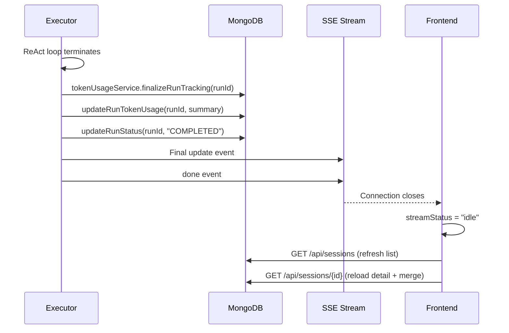

# End-to-End User Journey

## Overview

This document traces the complete lifecycle of a user interaction — from typing a message in the Agent UI through backend orchestration, LLM reasoning, tool execution, and back to the rendered response.

## Journey: "Fix the login bug in auth.ts"

### Phase 1: User Input

```
User types: "Fix the login bug in auth.ts"
User selects: Graph = Simple ReAct, LLM = Azure OpenAI
User clicks: Send
```

**Frontend actions** (`apps/web/app/app/agent/page.tsx`):

1. `AgentComposer.handleSend()` fires with the message text
2. `useSessionStream.handleSend()` is called:
   - **No active session** → `POST /api/sessions` with `{ graphId, message, llmProvider, workspaceId }`
   - **Active session** → `POST /api/sessions/{id}/continue` with `{ message, llmProvider }`
3. API returns `{ runId }` → stored as `activeSessionId` in `sessionStorage`
4. SSE connection opened to `GET /api/sessions/{runId}/stream`
5. Title generation triggered: `PUT /api/sessions/{runId}/title { generate: true }`

### Phase 2: Session Creation (Backend)

**API route handler** creates the run:

1. `agentGraphRunService.createRun(graphId, workspaceId, "agent")`
   - Inserts `AgentGraphRun` with `status: "PENDING"` into MongoDB
2. `agentGraphService.getGraph(graphId)` → loads graph definition
3. `buildInitialState(graph, mission)` → creates initial state:
   ```json
   {
     "mission": "Fix the login bug in auth.ts",
     "userInput": "Fix the login bug in auth.ts",
     "nodes": {},
     "execution": { "mode": "dag" }
   }
   ```
4. Node statuses initialized: `{ "simple_react": "PENDING" }`
5. Run status updated to `"RUNNING"`

### Phase 3: Executor Initialization

`AgentGraphExecutor.executeRunStreaming(runId)`:

1. **Workspace resolution**: `getWorkspaceByIdUnsafe(workspaceId)`
2. **Context binding**: `runWithWorkspaceContext(workspace, callback)`
3. **Context graph**: `ensureContextGraphReady(workspaceId, rootPath)` → loads from `.kletron/context_graph.json` or triggers scan
4. **Audit context**: `getAuditContextConfig(workspaceId)` → workspace-specific settings
5. **Token tracking**: `tokenUsageService.startRunTracking(runId)`
6. **Timeline setup**: `[{ id: "simple_react", label: "Agent (ReAct)", status: "pending" }]`
7. **Conversation history**: Initialize with user event:
   ```json
   {
     "id": "event-0",
     "kind": "user",
     "content": "Fix the login bug in auth.ts",
     "timestamp": "2026-03-25T18:00:00Z"
   }
   ```
8. **First SSE emit**: Timeline + user event sent to frontend

### Phase 4: Node Execution

For the `simple_react` node:

1. **Tool assembly**: `selectToolsByName(simpleReactToolNames)` → 23 MCP tools + `write_todos`
2. **System prompt**: `simpleReactSystemPrompt` (285 lines of identity, rules, strategies)
3. **Context enrichment**: Ranked context items from `ContextRanker` injected
4. **User prompt**: `"Fix the login bug in auth.ts"` (from `{{mission}}` template)

### Phase 5: ReAct Agent Loop

`streamReactAgentMessages()` in `packages/agent-core/src/reactAgentRunner.ts`:

```
┌─────────────────────────────────────────────────────┐
│ Iteration 1: Understand                             │
│                                                     │
│ LLM thinks: "I need to find auth.ts first"          │
│ LLM requests: search_code("login", path="auth.ts")  │
│                                                     │
│ → SSE: AgentEvent { kind: "tool", name: "search_code", toolArgs: "..." }
│ → MCP: McpClient.callTool("search_code", { query: "login", path: "auth.ts" })
│ → Tool result: { matches: [...] }                   │
│ → SSE: AgentEvent { kind: "tool", content: "..." }  │
├─────────────────────────────────────────────────────┤
│ Iteration 2: Inspect                                │
│                                                     │
│ LLM thinks: "Found the file, let me read it"       │
│ LLM requests: read_file("src/auth.ts")              │
│                                                     │
│ → Same flow: tool event → MCP call → result event   │
├─────────────────────────────────────────────────────┤
│ Iteration 3: Fix                                    │
│                                                     │
│ LLM thinks: "The bug is on line 42. Missing null check"
│ LLM requests: write_file("src/auth.ts", newContent)  │
│                                                     │
│ → SSE: tool event with args (original + modified)   │
│ → MCP: write to filesystem                          │
│ → SSE: tool result event                            │
├─────────────────────────────────────────────────────┤
│ Iteration 4: Respond                                │
│                                                     │
│ LLM outputs: "Fixed the login bug..."                │
│ → SSE: AgentEvent { kind: "assistant", content: "..." }
│ No more tool calls → ReAct loop terminates          │
└─────────────────────────────────────────────────────┘
```

### Phase 6: Event Streaming

For each LLM message, the executor:

1. **Extracts thinking**: Claude thinking blocks / OpenAI reasoning / `<think>` tags
2. **Creates AgentEvent**: Assigns sequential ID (`event-1`, `event-2`, ...)
3. **Records tool info**: `toolName`, `toolArgs`, `toolCallId`, `isError`
4. **Appends to conversation history**: Persistent in `state.conversationHistory`
5. **Emits via SSE**: `opts.onUpdate({ timeline, eventStream, outputs })`

**NDJSON stream format** (one JSON object per line):
```json
{"type":"update","payload":{"timeline":[...],"eventStream":[...],"outputs":{...}}}
{"type":"text_delta","payload":{"content":"Fixed"}}
{"type":"text_delta","payload":{"content":" the"}}
{"type":"done","payload":{"eventStream":[...]}}
{"type":"error","payload":{"message":"..."}}
```

### Phase 7: Frontend Rendering

`useSessionStream` processes SSE events:

1. **`update`**: Merges `eventStream` into `messages` state via `normalizeMessage()`
2. **`text_delta`**: Appends to `streamingText` for progressive rendering
3. **`done`**: Resets streaming state, triggers session detail reload

`MessageList` renders:

| Kind | Rendering |
|---|---|
| `user` | Chat bubble (right-aligned) |
| `assistant` | Chat bubble (left-aligned) with optional thinking popover |
| `tool` | Collapsible tool card grouped with adjacent tool events |

**Tool card content**:
- Tool name badge
- Collapsed: One-line summary
- Expanded: Arguments (syntax highlighted) + Output (scrollable)
- Error state: Red indicator + error message

### Phase 8: Completion



### Phase 9: Multi-Turn Continuation

When the user sends a follow-up (e.g., "Now add tests for the fix"):

1. `POST /api/sessions/{runId}/continue` with `{ message, llmProvider }`
2. `continueRun(runId, message)`:
   - Loads existing run state (including `conversationHistory`)
   - Appends new user event to `conversationHistory`
   - Updates `state.mission` to new message
   - Resets node statuses to `"PENDING"`
   - Increments `conversationTurns`
3. `executeRunStreaming(runId)` re-executes:
   - **Conversation history converted** to `BaseMessage[]` via `convertConversationHistoryToMessages()`
   - Passed as `extraMessages` to `streamReactAgentMessages()`
   - LLM receives full conversation context
4. New events appended to `conversationHistory` (IDs continue from last index)
5. SSE streams new events to frontend

## Journey: Drift Analysis (Multi-Node)

For the Drift Analysis graph (4-node DAG):

```
Phase 1: drift_intake (no tools)
  → Extracts goal, constraints, openQuestions from user request
  → Writes to state (stateMerge)

Phase 2: drift_scan (research tools)
  → Scans repo for config mismatches, dependency drift, etc.
  → Collects evidence with file paths and line numbers
  → Writes workingNotes and riskRegister to state

Phase 3: drift_delegate (core tools, delegate mode)
  → Validates scanner findings
  → Removes false positives, identifies root causes
  → Summary prompt extracts validatedRisks + falsePositives
  → Writes to state.drift

Phase 4: drift_report (no tools)
  → Synthesizes validated risks into finalSummary
  → Generates nextSteps for remediation
  → Writes to state (stateMerge)
```

**Frontend**: TimelinePanel shows 4 nodes with status indicators:
- 🔵 Pending → 🟡 Running → 🟢 Completed / 🔴 Failed

## Journey: Human-in-the-Loop

When `interruptBeforeTools` is enabled on a node:

```
1. Agent proposes tool calls (e.g., write_file)
2. Executor detects interruptBeforeTools=true
3. LangGraph interrupts before "tools" node
4. Run status → PAUSED, checkpoint saved to MongoDB
5. SSE sends paused event to frontend
6. Frontend shows approval UI (useSessionEdits)
7. User approves → POST /api/sessions/{id}/approve
8. continueRun() detects checkpoint with status "awaiting_approval"
9. Verifies graph hash hasn't changed
10. Resumes from checkpoint via resumeFromCheckpoint=true
11. Tools execute normally
12. Agent continues
```
