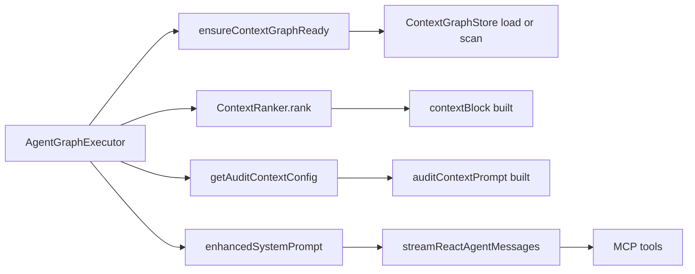

# Context Configuration and Context Graph (Deep Dive)

This document is a **full, detailed** explanation of the context system shown at `/app/config/context`. It describes **what context is**, **why it exists**, **how it is built**, **how it flows into agent runs**, and **how it ties into other features** (Deep Agent, Agent Graphs, repo scan, MCP tools, and workspace config).

The page actually covers **two different “context” systems**:

- **Context Graph (server-side, used for prompt injection):** built by `ContextScanner`, ranked by `ContextRanker`, injected in `AgentGraphExecutor`.
- **Repository Analysis Graph (client-side, used for Project Soul UI):** built by `repoScannerAgent`, used only for the Project Soul UI and local cache.

They serve different purposes and should not be conflated.

---

**Why This Exists**

Large codebases produce a lot of information, but LLM calls have token limits. The goal is to:

- **Reduce tool calls** (MCP reads) by pre-injecting the most likely relevant files.
- **Anchor reasoning** in the actual repo state, not vague guesses.
- **Provide a debugging surface** so you can see why certain files are prioritized.

The context system is the glue between:

- **Workspace configuration** (what repo is “active”).
- **Repo scans** (Project Soul & knowledge graph).
- **Agent Graph execution** (LLM runs).
- **MCP tool usage** (read/write file, diff, etc.).

---

**Key Concepts and Vocabulary**

**Context Graph (Injection Graph)**

- A graph of files (nodes) and relations (edges).
- Stored server-side at `/.numezis/context_graph.json` in the active workspace.
- Used to rank and inject relevant file paths into the LLM system prompt.

**Repository Analysis Graph (Project Soul Graph)**

- A shallow file tree graph (directories/files) created by a scan.
- Used to generate “Project Soul” via LLM: mission, invariants, tech stack.
- Stored **client-side** in localStorage and shown in the UI.

**Audit Context / Project Soul**

- Human-editable context (mission, goals, constraints).
- Stored in DB by `/api/context-config`.
- Injected into the prompt as “DOCUMENT CONTEXT”.

---

**UI Surface: `/app/config/context`**

Entry point: `apps/web/app/app/config/context/page.tsx`

Main component: `packages/ui/src/components/config/ContextConfigView.tsx`

The page has 3 tabs:

- **Project Soul**
  - Runs repo scan for a shallow graph + soul generation.
  - Displays node/edge/tech/invariant counts from that scan.
  - Lets you edit and save “Audit Context”.
  - Controls context injection toggle.

- **Active Context**
  - Visualizes the server-side Context Graph nodes.
  - Uses `/api/context/graph` GET.

- **Trace & Debug**
  - Lets you test context ranking for a hypothetical prompt.
  - Uses `/api/context/graph` POST.

---

**How the Context Graph is Built**

Files:

- `packages/server/src/context/graph/ContextGraphStore.ts`
- `packages/server/src/context/graph/ContextScanner.ts`
- `packages/shared/src/context/graph/ContextGraphTypes.ts`

**Scanning**

The scanner collects files with:

- Pattern: `**/*.{ts,tsx,js,jsx,md,json}`
- Excludes: `node_modules`, `.git`, `.next`

**Nodes**

For each file:

- `id`: absolute file path
- `type`: `file`
- `label`: basename
- `metadata`: extension, size, timestamps
- `stats`: `viewCount=0`, `editCount=0`

**Edges**

Only **relative imports** are parsed (regex) to create `imports` edges.

The edge direction is:

```
source = importing file
→ target = resolved file
```

This graph is persisted to:

```
<workspaceRoot>/.numezis/context_graph.json
```

---

**Context Graph Types**

Defined in `packages/shared/src/context/graph/ContextGraphTypes.ts`.

- `ContextNodeType`: `file | symbol | agent | diff | conversation`
- `ContextEdgeType`: `imports | extends | implements | contains | calls | edited_by | created_diff | referenced_in | similar_to`

**Important:** currently, only `file` nodes and `imports` edges are created by the scanner. The other types are placeholders for future expansions.

---

**Ranking Logic (Context Relevance)**

File: `packages/server/src/context/graph/ContextRanker.ts`

Inputs:

- `userPrompt`
- `editorState` (open files, active file, cursor, recent edits)
- `limit`

Signals and weights:

1. **Recency** (weight 0.3)
   - Uses `lastViewed` or `lastEdited`.
   - Decay: `recency = 1 / (1 + hoursAgo / 24)`

2. **Graph Proximity** (weight 0.25)
   - If node is an open file: +1.0
   - If node is 1-hop neighbor of open file: +0.5

3. **Prompt Mention** (weight 0.15)
   - Checks if node filename contains the **entire prompt** string.

The ranker filters to scores > 0.1 and returns the top N.

---

**How Context Gets Injected**

File: `packages/server/src/services/agentGraphExecutor.ts`

Flow per run node:

1. `ensureContextGraphReady()` loads or scans the graph.
2. `getAuditContextConfig()` loads `enabled` + audit context.
3. If enabled, `ContextRanker.rank()` is called.
4. A **context block** is added to the system prompt.
5. Audit Context is appended (if enabled).

Context block format:

```
## ACTIVE CONTEXT (Auto-Detected)
- Current File: <active file, if available>

The following files are likely relevant to your task:
- <abs path> (Relevance: NN% - Reason, Reason)
```

Final system prompt composition:

- Skill prompt prefix (if any)
- Node system prompt
- Context block (if enabled)
- Audit context prompt (if enabled)

---

**Audit Context / Project Soul**

Type and normalization:

- `packages/shared/src/documentContext.ts`
- Stored via `apps/web/app/api/context-config/route.ts`

The form allows fields like `startupPhase` and `riskTolerance`, but **normalization drops legacy-only fields**. Only fields defined in `DocumentContext` are persisted and injected.

Injected prompt header is:

```
DOCUMENT CONTEXT (must guide content & style):
```

This is appended after the context block.

---

**Repository Analysis (Project Soul) Pipeline**

File: `packages/agent-core/src/agents/repoScannerAgent.ts`

This scan is **not** the same as the Context Graph scan. It is used for:

- UI stats (Nodes/Edges/Stack/Invariants)
- LLM-generated mission + invariants
- Pre-filling audit context

Key behavior:

- Max depth: 3
- Max files per directory: 20
- Ignores common build/system folders
- Produces a **directory/file hierarchy graph**

Soul generation uses LLM and outputs:

- `mission`
- `invariants`
- `techStack`
- `architectureType`

This result is cached in localStorage as `numezis-repo-graph` and displayed under Project Soul.

---

**How This Links to Other Features**

**Deep Agent / Agent Graphs**

- The context injection happens inside `AgentGraphExecutor.executeRunStreaming`.
- Every agent graph node gets a system prompt that includes the context block.
- This affects routing, planning, and tool usage in **Deep Agent** flows.

**MCP Tools**

- Tools are invoked via `streamReactAgentMessages`.
- The context block **reduces the number of MCP tool calls** by putting relevant files directly in the prompt.
- The MCP client uses the same `workspace.rootPath` as the context scanner, so file paths align.

**Workspace Settings**

- `/api/config` returns the active workspace root.
- Both repo scans and context graph scans use this path.
- The cache status card compares the last scanned path vs current active workspace.

**Active Session Modal (Brain icon)**

- The context graph visualization is reused in other UI surfaces.
- Users can inspect it without leaving a chat session.

---

**Meaning of UI Metrics**

The “Repository Analysis” card shows:

- **Nodes**: number of directories + files found by `repoScannerAgent`
- **Edges**: parent → child relationships in that scan
- **Tech Stack**: LLM output from repo scan
- **Invariants**: LLM output from repo scan

These **do not** refer to the Context Graph used for injection.

The “Active Context” tab shows:

- **Context Graph nodes** (currently only file nodes)
- Sorting is by `viewCount` and `editCount`, which are currently always 0

---

**Current Gaps / Limitations (Important)**

These are critical to understand actual behavior:

- Only `file` nodes are created in the context graph.
- Only `imports` edges are created.
- `EditorStateManager` has no upstream updates, so open-file proximity is effectively off.
- `viewCount` and `editCount` are initialized but never updated anywhere in code.
- Prompt mention scoring checks if the **entire prompt** matches part of a filename, which rarely triggers.
- No snippets are injected yet; only file paths + reasons.
- Audit fields like `startupPhase` and `riskTolerance` are dropped during normalization.

---

**Execution Flow Diagram (Context Injection)**



---

**Execution Flow Diagram (Repo Scan / Project Soul)**

```mermaid
flowchart LR
  U[UI: Project Soul tab] --> A[/api/repo-scan]
  A --> B[repoScannerAgent]
  B --> C[scanDirectory]
  B --> D[generateProjectSoul via LLM]
  A --> E[ContextScanner scanWorkspace]
  A --> F[ContextGraphStore save]
  A --> G[SSE logs + result]
  G --> H[localStorage cache]
  G --> I[AuditContext prefill]
```

---

**Quick Reference: Key Files**

Context Graph:

- `packages/shared/src/context/graph/ContextGraphTypes.ts`
- `packages/server/src/context/graph/ContextGraphStore.ts`
- `packages/server/src/context/graph/ContextScanner.ts`
- `packages/server/src/context/graph/ContextRanker.ts`
- `packages/server/src/context/graph/EditorStateManager.ts`
- `packages/server/src/services/agentGraphExecutor.ts`
- `apps/web/app/api/context/graph/route.ts`

Project Soul / Repo Scan:

- `packages/agent-core/src/agents/repoScannerAgent.ts`
- `apps/web/app/api/repo-scan/route.ts`
- `packages/ui/src/components/config/ContextConfigView.tsx`

Audit Context:

- `packages/shared/src/documentContext.ts`
- `apps/web/app/api/context-config/route.ts`
- `packages/ui/src/components/AuditContextForm.tsx`

UI Visualizers:

- `packages/ui/src/components/context/ContextVisualizer.tsx`
- `packages/ui/src/components/context/ContextTracePanel.tsx`

---

**What You Should Know Before Modifying This**

- If you change scanner behavior, update both:
  - `ContextScanner` (server injection graph)
  - `repoScannerAgent` (Project Soul graph)
- The UI conflates “graph” terminology for two distinct systems.
- Prompt injection happens once per **LangGraph node**, not per chat message.
- The context graph only updates automatically when:
  - the repo scan runs, or
  - a run starts and the graph is empty.

If you want real-time relevance, you need to wire editor state updates and view/edit stats.

