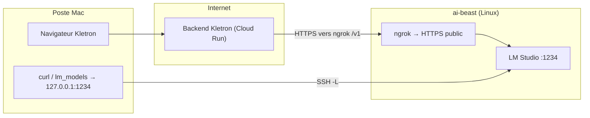

# LM Studio sur une machine distante (ai-beast) — tunnels, ngrok et Kletron

Ce document décrit une mise en production **personnelle / équipe** où :

- **LM Studio** tourne sur une machine Linux dédiée (**ai-beast**, GPU).
- Vous développez ou utilisez Kletron depuis un **Mac**.
- Vous exposez l’API compatible OpenAI de LM Studio vers **Kletron hébergé** (ex. `https://www.kletron.com`) via **ngrok**.

Références code : configuration LM Studio côté produit dans **`docs/agentic/02-llm-providers.md`** ; variables d’environnement dans **`env.example`**.

---

## Vue d’ensemble du flux



- **Depuis le cloud** (site Kletron en prod), le backend appelle l’URL HTTPS ngrok avec le suffixe **`/v1`** — il n’a pas besoin du tunnel SSH du Mac.
- **Depuis le Mac** (scripts `lm_models`, tests rapides), vous utilisez **`http://127.0.0.1:1234`** **après** avoir monté le tunnel SSH **`lm_up`** (voir ci‑dessous).

---

## Prérequis sur le Mac (`~/.zshrc`)

Définir la cible SSH de la bête (exemple) :

```bash
export AI_BEAST="romain@ai-beast"
# ou: export AI_BEAST="romain@100.79.53.99"   # via Tailscale si vous préférez l’IP
```

Clé SSH sans mot de passe ou agent SSH chargé pour que les alias fonctionnent sans interaction.

---

## Alias shell — rôle de chaque commande

Ces alias vivent typiquement dans **`~/.zshrc`** ; après modification : `source ~/.zshrc`.

### `lm_start` — démarrer le serveur LM Studio sur ai-beast

```bash
ssh "$AI_BEAST" "/home/romain/.lmstudio/bin/lms server start"
```

- Exécute **sur la machine distante** la CLI officielle LM Studio (`lms`) pour lancer le **serveur local** sur le port configuré (souvent **1234**).
- Ne crée pas de tunnel : LM Studio écoute sur **ai-beast** (initialement `127.0.0.1:1234` ; vous pouvez le passer en **`0.0.0.0:1234`** si vous voulez aussi Tailscale / LAN direct sans SSH).

### `lm_up` — tunnel SSH Mac → LM Studio sur la bête

```bash
ssh -fN \
  -o ExitOnForwardFailure=yes \
  -o ServerAliveInterval=30 \
  -o ServerAliveCountMax=3 \
  -L 1234:127.0.0.1:1234 \
  "$AI_BEAST"
```

- **`−L 1234:127.0.0.1:1234`** : sur le Mac, **localhost:1234** est redirigé vers **127.0.0.1:1234 sur ai-beast** (où LM Studio écoute en local).
- **`−fN`** : SSH part en arrière-plan sans shell interactif.
- **`ExitOnForwardFailure=yes`** : échec net si le forward ne peut pas s’établir.
- **`ServerAlive*`** : garde la session vivante à travers des NAT / pare-feu agressifs.

**Sans `lm_up`**, `curl http://127.0.0.1:1234/...` sur le Mac ne parle **pas** à la bête.

### `lm_models` — liste des modèles vus depuis le Mac

```bash
curl -s http://127.0.0.1:1234/v1/models | jq
```

- Suppose que **`lm_up`** est actif **ou** que LM Studio tourne localement sur le Mac sur 1234.
- C’est un contrôle rapide de l’API **OpenAI-compatible** (`/v1/models`).

### `lm_down` — libérer le port 1234 sur le Mac

```bash
pids=$(lsof -tiTCP:1234 -sTCP:LISTEN 2>/dev/null)
[ -n "$pids" ] && kill $pids || true
```

- Tue le **processus qui écoute sur 1234 sur le Mac** (typiquement la session **`ssh -L`** du tunnel).
- **Attention** : si LM Studio tournait **localement** sur le Mac sur 1234, cette commande pourrait aussi l’arrêter selon ce qui écoute — à utiliser en connaissance de cause.

---

## `lm_online` — démarrage « prod Kletron » en une commande

Fonction ou alias **personnel** dans `~/.zshrc` (non fourni par le dépôt Kletron) qui enchaîne typiquement :

1. **`lm_start`** — démarre LM Studio sur **ai-beast**.
2. Démarre **ngrok** sur **ai-beast** vers **`http://127.0.0.1:1234`** (ou vérifie qu’il tourne déjà).
3. Affiche l’URL HTTPS publique et rappelle la **Base URL** Kletron (`…/v1`) + le nom du modèle par défaut.

Référence des alias « classiques » sur le Mac :

```bash
alias lm_start='ssh "$AI_BEAST" "/home/romain/.lmstudio/bin/lms server start"'
alias lm_up='ssh -fN \
  -o ExitOnForwardFailure=yes \
  -o ServerAliveInterval=30 \
  -o ServerAliveCountMax=3 \
  -L 1234:127.0.0.1:1234 \
  "$AI_BEAST"'
alias lm_models='curl -s http://127.0.0.1:1234/v1/models | jq'
alias lm_down='pids=$(lsof -tiTCP:1234 -sTCP:LISTEN 2>/dev/null); [ -n "$pids" ] && kill $pids || true'
```

Adapter **`/home/romain/.lmstudio/bin/`** si votre utilisateur ou installation LM Studio diffère.

Exemple de sortie utile pour **`lm_online`** :

```text
Starting LM Studio on ai-beast...
Success! Server is now running on port 1234
Starting ngrok public tunnel...
https://sulphate-linseed-curse.ngrok-free.dev

✅ Kletron Base URL:
https://sulphate-linseed-curse.ngrok-free.dev/v1
```

**Important** : l’URL ngrok **change** souvent à chaque session (plan gratuit). Il faut alors **mettre à jour** la Base URL dans Kletron ou utiliser un **domaine réservé** ngrok.

---

## Réglages dans l’UI Kletron

Chemin : **Configuration → LLM → LM Studio**.

| Champ | Valeur |
|--------|--------|
| **Base URL** | Ex. `https://sulphate-linseed-curse.ngrok-free.dev/v1` — toujours **`https://…/v1`** (API OpenAI-compatible). |
| **Model name** | Ex. `nvidia/nemotron-3-nano-omni` (doit correspondre à un id renvoyé par `/v1/models`). |
| **API Key** | Optionnel selon votre config LM Studio ; sinon laissez vide ou valeur attendue par LM Studio. |

Ensuite : **Save Changes** → **List Models** / **Test Connection**.

Le **Test Connection** part du **backend** Kletron (Next.js). En prod, c’est bien le serveur cloud qui doit joindre ngrok — pas votre Mac.

---

## Tailscale (optionnel)

Si **Tailscale** est installé sur **ai-beast** et que LM Studio écoute sur **`0.0.0.0:1234`**, vous pouvez depuis le Mac :

```bash
curl -sS "http://100.79.53.99:1234/v1/models"
```

(remplacez par l’IP Tailscale réelle de **ai-beast**.)

**Limite** : les machines **hors** votre tailnet (et le backend Kletron sur GCP **sans** Tailscale) ne voient pas cette IP. Pour **kletron.com**, il faut donc un **tunnel public** (ngrok, Cloudflare Tunnel, Tailscale Funnel, etc.), pas seulement Tailscale.

---

## Kletron hébergé et chemins de workspace (`422 WORKSPACE_PATH_MISSING`)

Les workspaces stockés en base peuvent avoir un `rootPath` du type **`/Users/…/projet`** (chemins macOS). Sur **Cloud Run**, ce dossier **n’existe pas** : les routes qui résolvent le workspace peuvent répondre **`422`** avec le code **`WORKSPACE_PATH_MISSING`**.

Pour un déploiement où vous acceptez des sessions sans accès disque au repo sur le serveur :

- Définir **`WORKSPACE_SKIP_LOCAL_FS_VALIDATION=true`** (voir commentaire dans **`env.example`** et logique dans **`packages/server/src/services/workspaceService.ts`**).
- Pour du mode code complet avec outils fichier, il faudrait un **`rootPath` réellement présent** dans l’environnement qui exécute l’API (clone Git, volume monté, etc.).

Ce sujet est **indépendant** du tunnel LM Studio : corrigez les deux si vous utilisez à la fois **prod web** et **LLM local exposé**.

---

## Sécurité — checklist courte

- **Ngrok** expose LM Studio sur Internet : coupez le tunnel quand vous n’en avez pas besoin.
- Activez une **clé API** côté LM Studio si disponible ; renseignez la même dans Kletron.
- Sur **ai-beast**, un firewall restrictif + LM Studio uniquement sur interfaces nécessaires réduit la surface d’attaque sur LAN/Tailscale.
- Ne commitez **pas** votre authtoken ngrok ni vos URLs définitives dans le dépôt public.

---

## Récap des fichiers Kletron liés

| Fichier | Rôle |
|---------|------|
| `env.example` | `LMSTUDIO_*`, `WORKSPACE_SKIP_LOCAL_FS_VALIDATION`, `KLETRON_REMOTE_FILE_MCP_SLUG`, prod GCP |
| `docs/agentic/02-llm-providers.md` | Comportement LM Studio dans le code |
| **[workspace-local-files-hosted-kletron.md](./workspace-local-files-hosted-kletron.md)** | Fichiers locaux + SaaS (MCP tunnelé) |
| `infra/gcp/provision_secrets.py` | Peut pousser ces variables si présentes dans `.env` |

---

## Dépannage rapide

| Symptôme | Piste |
|----------|--------|
| `lm_models` vide / erreur connexion sur le Mac | `lm_up` actif ? LM Studio démarré sur ai-beast ? |
| Kletron prod « Connection failed » pour LM Studio | Ngrok en cours sur ai-beast ? URL `/v1` à jour ? |
| `curl` vers IP Tailscale échoue | LM Studio écoutait-il seulement sur `127.0.0.1` ? Passer à `0.0.0.0` si vous voulez Tailscale sans SSH. |
| Agent web `422 WORKSPACE_PATH_MISSING` | Chemins workspace Mac vs serveur — voir section workspace ci‑dessus. |
